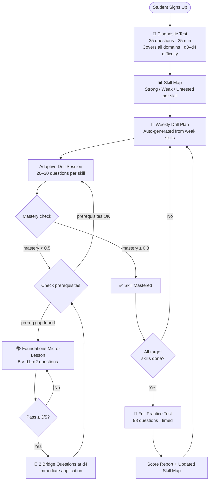
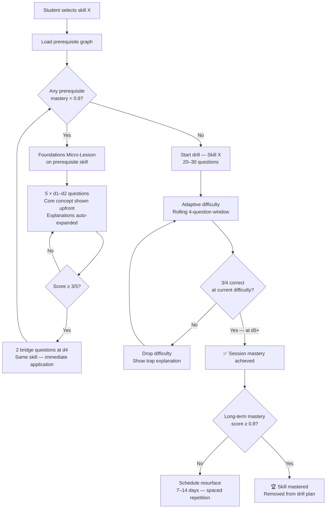

# 14 — Adaptive Learning Engine

---

## Why Diagnostic-First?

Most SAT platforms lead with a full 98-question practice test. The student gets a score and stares at it not knowing what to fix. Good human tutors never start that way — the first session is always a diagnostic: *where exactly are you losing points?*

Our model:

> **Find your gaps in 25 minutes. Fix them systematically. Measure progress with a full test only when ready.**

This is not a novel idea — it is the explicit design of the most effective free SAT prep tool in existence (Khan Academy Official Practice, which produced +115 average score gains in a College Board study). The academic research supporting this model is among the most replicated in educational psychology. See [Research Backing](#research-backing) below.

---

## Product Flow



---

## Diagnostic Test Design

The diagnostic is **not** a mini practice test. It is a triage instrument.

| Attribute | Value |
|---|---|
| Length | 35–40 questions |
| Time | ~25 minutes |
| Difficulty | d3–d4 (best discriminators — not too easy, not too hard) |
| Coverage | All 8 domains, all 66 skills (1–2 questions each) |
| Branching | Adaptive: poor performance in a domain triggers 1–2 follow-up questions |
| Output | Per-skill mastery estimate (strong / weak / untested) |
| Pool tag | `pool: practice` |

**Important framing:** The diagnostic produces a *rough map, not a precise score*. It is updated continuously as the student drills. The map gets sharper with every session.

---

## Session Types

| Type | Questions | Difficulty | Purpose |
|---|---|---|---|
| `diagnostic` | 35–40 | d3–d4 | Initial skill gap identification |
| `adaptive_drill` | 20–30 | Adaptive d2–d7 | Targeted skill improvement |
| `foundations` | 5 + 2 bridge | d1–d2 + d4 | Floor skill remediation |
| `practice_test` | 98 | Mirrors real SAT | Progress measurement checkpoint |

---

## Mastery Loop



### Why the 2 Bridge Questions Matter

Research (Saga Education, Carnegie Mellon) shows that staying on easy remediation content too long creates a low-expectation loop. After passing a foundations micro-lesson, the student immediately applies the concept to a real d4 SAT question. This closes the gap between remediation and actual test performance.

---

## Foundations Micro-Lesson

Triggered when a student fails a **floor skill** (Level 1 in the prerequisite graph) with mastery < 0.5.

**Floor skills (9 total):**

| Math | R&W |
|---|---|
| Linear equations in one variable | Words in context |
| Ratios and rates | Central ideas and details |
| Lines and angles | Sentence boundaries |
| Area of 2D figures | Noun number and possessives |
| Measures of center | |

**Session format:**
1. Core concept shown before Question 1 ("Before we begin, here's the key idea…")
2. 5 questions, all d1–d2
3. `explanationSteps` always auto-expanded (never hidden behind a click)
4. No timer
5. Pass threshold: 3/5
6. On pass: 2 bridge questions at d4
7. On fail: repeat with different d1–d2 questions from pool

---

## Adaptive Difficulty Within a Session

The engine adjusts difficulty based on a rolling 4-question window:

| Window result | Action |
|---|---|
| 0–1 correct | Drop one difficulty level |
| 2 correct | Hold current level |
| 3 correct | Hold, show harder next |
| 4 correct | Increase one difficulty level |

Mastery is declared when the student achieves 3/4 correct **at d5 or above**.

---

## Error Classification

Every wrong answer is classified by error type:

| Type | Meaning |
|---|---|
| `CONCEPT` | Student does not understand the underlying concept |
| `APPLICATION` | Understands the concept but cannot apply it in context |
| `SETUP` | Can solve but sets up the problem incorrectly |
| `CARELESS` | Arithmetic or reading error on a question they likely know |

The dominant error type for each skill surfaces in the student's skill map and informs how the drill session structures feedback.

---

## Research Backing

The diagnostic-first → adaptive drill → full test model is not experimental. It is the design of the most effective SAT prep tool available and is supported by decades of learning science research.

### Key Evidence

| Finding | Source | Confidence |
|---|---|---|
| Khan Academy personalized SAT practice (20 hrs) → **+115 point average gain**, nearly 2× non-users | College Board / Khan Academy joint study (2017) | High |
| Intelligent Tutoring Systems outperform traditional instruction by **g = 0.42–0.57**; on par with one-on-one human tutoring | Ma et al. (2014), 107 studies, 14,321 participants | High |
| Prerequisite remediation before advancement **tripled mastery rates** on final exams | Carnegie Mellon teaching research | High |
| Spaced retrieval practice outperforms massed practice by **d = 0.54** | 2024 systematic review on high-stakes exam prep | Very High |
| A 35-question diagnostic reliably identifies directional gaps (not precise scores) | Psychometrics literature; PrepScholar uses 60Q for same purpose | Medium |

### Closest Competitors Using This Model

- **PrepScholar** — 60-question diagnostic → adaptive study plan → skills retired when mastered
- **Khan Academy Official SAT Practice** — PSAT-linked diagnostic → personalized plan → mastery-based progression

### What Our Model Adds

Khan Academy has PSAT data as their diagnostic input (effectively 800+ items of prior evidence). We build our signal from scratch with a purpose-built diagnostic, which means diagnostic quality is critical — it is the only information we have at the start.

---

## Session Data Model

```
user_skill_mastery
├── userId
├── skillKey
├── attempts
├── correct
├── dominantErrorType    ← CONCEPT / APPLICATION / SETUP / CARELESS
├── masteryScore         ← 0.0 – 1.0
├── lastAttemptedAt
└── nextResurfaceAt      ← spaced repetition schedule

session_answer
├── sessionId
├── questionId
├── studentAnswer
├── isCorrect
├── errorType            ← classified per wrong answer
├── timeSpentSeconds
└── answeredAt
```
