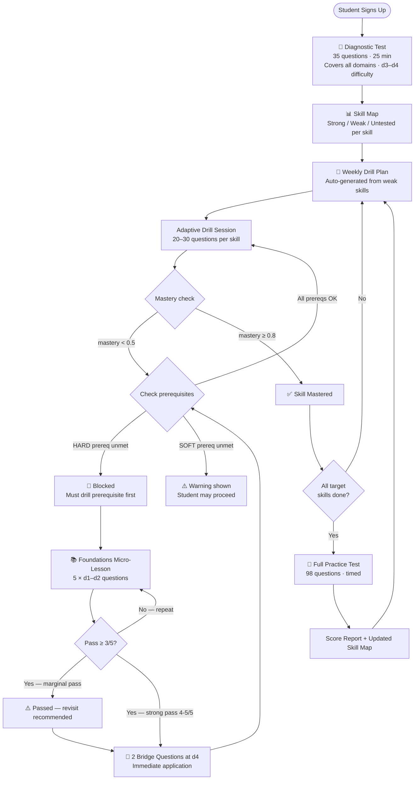
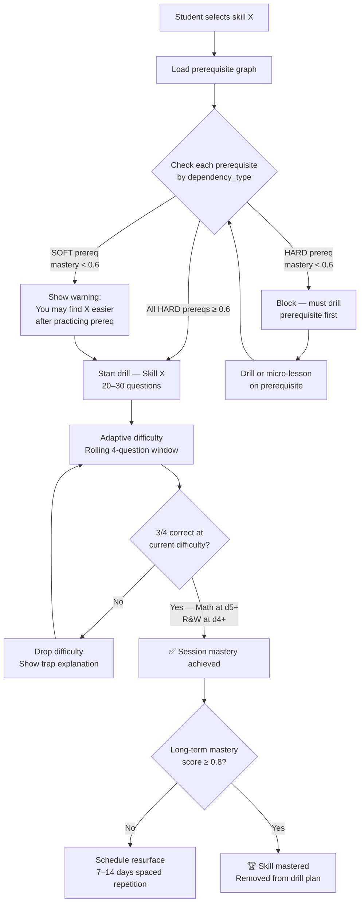

# 14 — Adaptive Learning Engine

---

## Why Diagnostic-First?

Most SAT platforms lead with a full 98-question practice test. The student gets a score and stares at it not knowing what to fix. Good human tutors never start that way — the first session is always a diagnostic: *where exactly are you losing points?*

Our model:

> **Find your gaps in 25 minutes. Fix them systematically. Measure progress with a full test only when ready.**

This is not a novel idea — it is the explicit design of the most effective free SAT prep tool in existence (Khan Academy Official Practice, which produced +115 average score gains in a College Board study). The academic research supporting this model is among the most replicated in educational psychology. See [Research Backing](#research-backing) below.

---

## Product Flow



---

## Diagnostic Test Design

The diagnostic is **not** a mini practice test. It is a triage instrument.

### Why Not 1 Question Per Skill?

66 skills × 1 question = 66 questions and still unreliable — a student can get lucky or make a careless mistake. Even 2 per skill = 132 questions, longer than a full SAT.

The solution: **test at domain level first, zoom into weak domains only.**

---

### Two-Stage Adaptive Design

#### Stage 1 — Domain Triage (24 questions, ~15 min)

3 questions per domain × 8 domains = 24 questions. Each question is tagged to a skill, but the judgment at this stage is at **domain level**.

| Domain score | Classification | Action |
|---|---|---|
| 3/3 correct | Strong | Skip — no Stage 2 for this domain |
| 2/3 correct | Developing | Light zoom — 2 questions on weakest skill only |
| 0–1/3 correct | Weak | Deep zoom — Stage 2 for this domain |

3 questions is enough to reliably classify a domain. It is not enough to classify individual skills — that happens in Stage 2 and then in actual drill sessions.

#### Stage 2 — Skill Zoom (weak domains only, ~10 min)

For each **Weak** domain: ask 2 questions on each of the 2–3 most foundational skills in that domain (floor skills and Level 2 skills — not the full domain).

**Example — Advanced Math domain is Weak (1/3 in Stage 1):**
```
Stage 2 tests:
  equivalent_expressions: 2 questions → 0/2 → Weak (confirmed)
  factoring:              2 questions → 1/2 → Developing
  quadratic_equations:    2 questions → 0/2 → Weak (confirmed)

Remaining Advanced Math skills → inferred weak (domain was weak, not directly tested)
```

#### Total Length by Performance

| Student type | Stage 1 | Stage 2 | Total | Time |
|---|---|---|---|---|
| Strong (3+ strong domains) | 24Q | ~6Q | ~30Q | ~20 min |
| Average (mixed performance) | 24Q | ~14Q | ~38Q | ~25 min |
| Weak (most domains weak) | 24Q | ~20Q | ~44Q | ~30 min |

Strong students finish faster. Weaker students get more signal exactly where they need it.

---

### Skill Map Confidence Levels

After the diagnostic, every skill on the skill map carries a confidence level:

| Confidence | Source | Label shown |
|---|---|---|
| **Measured** | Directly tested in Stage 2 (2 questions) | 🔴 Weak / ⚠️ Developing |
| **Inferred weak** | Skill in a Weak domain, not directly tested | 🔴 Likely weak |
| **Inferred strong** | Skill in a Strong domain, not directly tested | ✅ Likely strong |
| **Untested** | Skill in a Developing domain, not tested | ⬜ Not tested yet |

The skill map is honest about confidence. A student sees:
```
Systems of equations    🔴 Weak          ← 2 questions, confident
Polynomial functions    🔴 Likely weak   ← inferred from domain
Linear equations        ⬜ Not tested    ← domain was developing
Lines and angles        ✅ Likely strong ← inferred from domain
```

**The map sharpens with every drill session.** After 20 questions on a skill, the mastery score is real data, not inference.

---

### Summary

| Attribute | Value |
|---|---|
| Stage 1 | 24 questions · 3 per domain · domain-level classification |
| Stage 2 | 0–20 questions · triggered only for Weak domains · skill-level zoom |
| Total length | 30–44 questions · ~20–30 min |
| Difficulty | d3–d4 throughout (best discriminators) |
| Pool tag | `pool: practice` |
| Output | Per-skill status with confidence level (measured / inferred / untested) |

**Important framing:** The diagnostic produces a *starting map, not a precise score*. Confidence builds with every drill session. The map gets sharper over time.

---

## Session Types

| Type | Questions | Difficulty | Purpose |
|---|---|---|---|
| `diagnostic` | 35–40 | d3–d4 | Initial skill gap identification |
| `adaptive_drill` | 20–30 | Adaptive d2–d7 | Targeted skill improvement |
| `foundations` | 5 + 2 bridge | d1–d2 + d4 | Floor skill remediation |
| `practice_test` | 98 | Mirrors real SAT | Progress measurement checkpoint |

---

## Mastery Loop



### Why the 2 Bridge Questions Matter

Research (Saga Education, Carnegie Mellon) shows that staying on easy remediation content too long creates a low-expectation loop. After passing a foundations micro-lesson, the student immediately applies the concept to a real d4 SAT question. This closes the gap between remediation and actual test performance.

---

## Prerequisite Dependency Types

Not all prerequisites are equal. Math prerequisites are hard blockers; R&W prerequisites are softer guidance.

| Type | Behaviour | Examples |
|---|---|---|
| `HARD` | Engine **blocks** the skill until prerequisite mastery ≥ 0.6 | `factoring` requires `equivalent_expressions` — you literally cannot factor without this |
| `SOFT` | Engine shows a **recommendation warning** but lets student proceed | `inferences` benefits from `central_ideas` but a student can attempt inferences at mastery 0.5 |

**Rule:** All Math prerequisites default to `HARD`. All R&W prerequisites default to `SOFT`. Exceptions are noted in `docs/15-prerequisite-graph.md`.

This field is stored in the taxonomy as `dependency_type` on each prerequisite reference:
```json
"prerequisites": [
  { "skillKey": "equivalent_expressions", "dependency_type": "HARD" }
]
```

---

## Mastery Declaration Threshold

Mastery is declared when the student achieves **3/4 correct in a rolling window at the threshold difficulty**.

| Section | Mastery threshold difficulty | Rationale |
|---|---|---|
| Math | d5 or above | SAT Math hard questions require solid conceptual depth |
| R&W | d4 or above | SAT R&W peaks at d4; d5+ questions are rare in the real exam |
| After micro-lesson | d4 (bridge questions) | Floor skill remediation targets real-SAT difficulty, not beyond |

**Why d5 may be too high for some skills:** Skills like `words_in_context` or `noun_number_possessives` rarely appear above d4 on the real SAT. Requiring d5 mastery for these would over-train beyond what the exam tests. The R&W threshold of d4 addresses this.

---

## Mastery Score Calculation

`masteryScore` in `user_skill_mastery` is a **recency-weighted accuracy** across all attempts at this skill.

```
masteryScore = Σ(result_i × weight_i) / Σ(weight_i)

Where:
  result_i = 1.0 (correct) or 0.0 (wrong)
  weight_i = 0.8 ^ (position from most recent)
             most recent attempt = position 0, weight = 1.0
             2nd most recent     = position 1, weight = 0.8
             3rd most recent     = position 2, weight = 0.64
             ... and so on

Cap at last 20 attempts (older attempts have negligible weight).
```

**Example:** Student answered: correct, wrong, correct, correct (most recent last)
```
weights:  0.51,  0.64,  0.80,  1.00   (oldest → newest)
results:  1.0,   0.0,   1.0,   1.0
score = (0.51 + 0 + 0.80 + 1.00) / (0.51 + 0.64 + 0.80 + 1.00) = 2.31 / 2.95 = 0.78
```

**Recalculated:** after every answer submitted in any session type.

---

## Foundations Micro-Lesson

Triggered when a student fails a **floor skill** (Level 1 in the prerequisite graph) with mastery < 0.5.

**Floor skills (9 total):**

| Math | R&W |
|---|---|
| Linear equations in one variable | Words in context |
| Ratios and rates | Central ideas and details |
| Lines and angles | Sentence boundaries |
| Area of 2D figures | Noun number and possessives |
| Measures of center | |

**Session format:**
1. Core concept shown before Question 1 ("Before we begin, here's the key idea…")
2. 5 questions, all d1–d2
3. `explanationSteps` always auto-expanded (never hidden behind a click)
4. No timer
5. Pass thresholds:
   - **2/5 or below** → repeat micro-lesson with different questions
   - **3/5** → marginal pass — proceed to bridge questions with "Consider revisiting this skill soon" note
   - **4/5 or 5/5** → strong pass — proceed to bridge questions, no caveat
6. On any pass: 2 bridge questions at d4
7. On fail: repeat with different d1–d2 questions from pool (never reuse in same day)

---

## Adaptive Difficulty Within a Session

The engine adjusts difficulty based on a rolling 4-question window:

| Window result | Action |
|---|---|
| 0–1 correct | Drop one difficulty level |
| 2 correct | Hold current level |
| 3 correct | Hold, show harder next |
| 4 correct | Increase one difficulty level |

**Mastery declared:** 3/4 correct at d5+ (Math) or d4+ (R&W).

---

## Error Classification

Every wrong answer is classified by error type and stored in `session_answer.error_type`.

| Type | Meaning |
|---|---|
| `CONCEPT` | Student does not understand the underlying concept |
| `APPLICATION` | Understands the concept but cannot apply it in context |
| `SETUP` | Can solve but sets up the problem incorrectly |
| `CARELESS` | Arithmetic or reading error on a question they likely know |

### Mapping from trapCategory and GapAnalysisService

The existing `trapCategory` on questions and `GapAnalysisService` gap tags map to error types as follows. This mapping lives in `MistakeClassifierService` (to be built in Phase 4).

| trapCategory | Gap tag (GapAnalysisService) | errorType | Notes |
|---|---|---|---|
| `sign_error` | "I made a calculation mistake" | `CARELESS` | timeSpentSeconds < 30 strengthens signal |
| `arithmetic` | "I made a calculation mistake" | `CARELESS` | |
| `off_by_one` | "I made a calculation mistake" | `CARELESS` | |
| `wrong_formula` | "I didn't know the formula/rule" | `CONCEPT` | |
| `wrong_method` | "I didn't know the formula/rule" | `CONCEPT` | |
| `misread_question` | "I confused X with Y" | `APPLICATION` | |
| `incomplete_setup` | "I set up the equation wrong" | `SETUP` | |
| `algebra_manipulation` | "I confused X with Y" | `APPLICATION` | |
| `unit_error` | "I confused X with Y" | `APPLICATION` | |

**CARELESS signal boost:** if `timeSpentSeconds < 30` AND the student has previously answered this skill correctly, bias toward `CARELESS` regardless of trap category.

The dominant error type per skill (`user_skill_mastery.dominantErrorType`) is the **most frequent** `errorType` across all wrong answers for that skill. Recalculated after each session.

---

## Data Model Clarification

`dominantErrorType` exists in two places with different meanings:

| Field | Location | Meaning |
|---|---|---|
| `errorType` | `session_answer` | Per-attempt classification. Set once on wrong answer, null on correct. |
| `dominantErrorType` | `user_skill_mastery` | Aggregate across all attempts for this skill. Most frequent `errorType`. Updated after each session. |

These are not redundant — `session_answer.errorType` is the raw data; `user_skill_mastery.dominantErrorType` is the derived summary shown to the student.

---

## Weekly Drill Plan — Priority Formula

The engine selects **3–4 skills per week** (not more — prevents overwhelm).

**Priority score formula:**

```
priority = (1 - masteryScore) × domain_weight × time_factor

domain_weight — based on % of real SAT questions:
  Algebra:          3.5   (35% of Math section)
  Advanced Math:    3.5
  PS & Data:        1.5   (15% of Math section)
  Geometry:         1.5
  Craft & Structure: 2.8  (28% of R&W section)
  Info & Ideas:     2.6
  Standard English: 2.6
  Expression:       2.0

time_factor — adjusts for proximity to test date:
  > 8 weeks to test:  1.0  (work from foundations up — follow prerequisite order)
  4–8 weeks to test:  1.2  (boost high domain_weight skills)
  < 4 weeks to test:  1.5  (prioritise highest-impact skills only, skip foundations)
```

**Selection:** Sort all weak skills (mastery < 0.7) by priority score descending. Take top 3–4. Skills in active spaced repetition resurface are added on top (not counted against the 3–4 limit).

**Prerequisite ordering:** if a weak skill has an unmet HARD prerequisite, the prerequisite replaces the skill in the plan — a student never sees "drill quadratic functions" when `factoring` is still weak.

---

## Research Backing

The diagnostic-first → adaptive drill → full test model is not experimental. It is the design of the most effective SAT prep tool available and is supported by decades of learning science research.

### Key Evidence

| Finding | Source | Confidence |
|---|---|---|
| Khan Academy personalized SAT practice (20 hrs) → **+115 point average gain**, nearly 2× non-users | College Board / Khan Academy joint study (2017) | High |
| Intelligent Tutoring Systems outperform traditional instruction by **g = 0.42–0.57**; on par with one-on-one human tutoring | Ma et al. (2014), 107 studies, 14,321 participants | High |
| Prerequisite remediation before advancement **tripled mastery rates** on final exams | Carnegie Mellon teaching research | High |
| Spaced retrieval practice outperforms massed practice by **d = 0.54** | 2024 systematic review on high-stakes exam prep | Very High |
| A 35-question diagnostic reliably identifies directional gaps (not precise scores) | Psychometrics literature; PrepScholar uses 60Q for same purpose | Medium |

### Closest Competitors Using This Model

- **PrepScholar** — 60-question diagnostic → adaptive study plan → skills retired when mastered
- **Khan Academy Official SAT Practice** — PSAT-linked diagnostic → personalized plan → mastery-based progression

---

## Session Data Model

```
user_skill_mastery
├── userId
├── skillKey
├── attempts
├── correct
├── dominantErrorType    ← most frequent errorType across all wrong answers for this skill
├── masteryScore         ← recency-weighted accuracy (0.0–1.0), see formula above
├── lastAttemptedAt
└── nextResurfaceAt      ← set when mastery ≥ 0.8 for spaced repetition

session_answer
├── sessionId
├── questionId
├── studentAnswer
├── isCorrect
├── errorType            ← per-attempt classification (null when correct)
├── timeSpentSeconds
└── answeredAt
```
