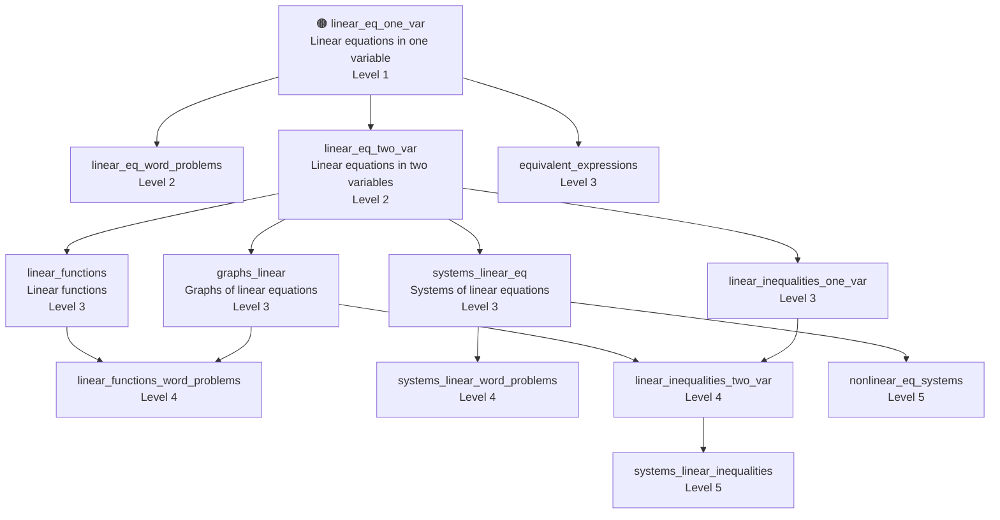
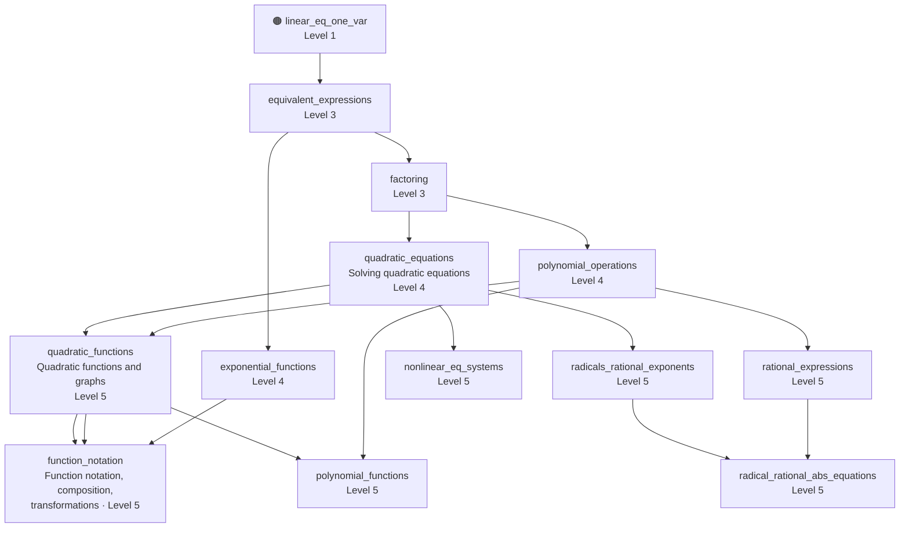
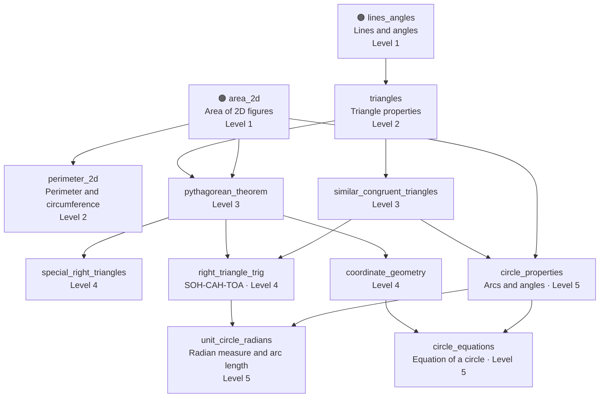
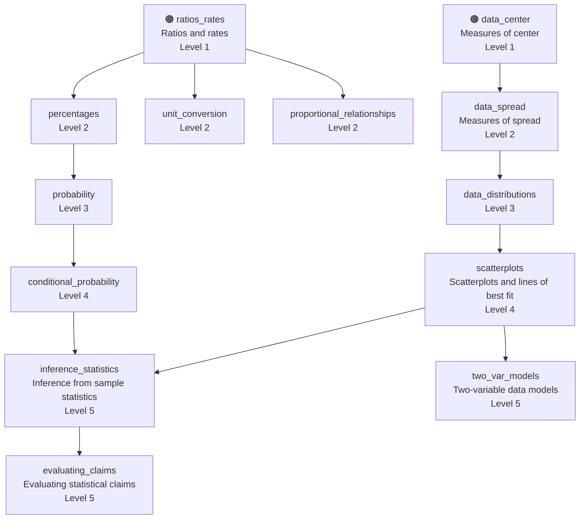
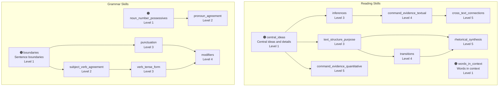
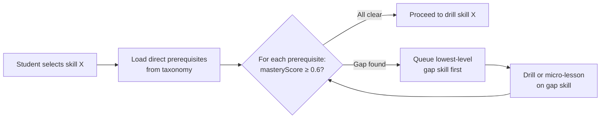

# 15 — Prerequisite Graph

---

## Overview

The SAT skill taxonomy is structured as a **5-level directed acyclic graph (DAG)**, not a flat list. Every skill has 0–3 direct prerequisites. When a student fails a skill, the engine checks whether prerequisite gaps are the root cause before drilling the skill itself.

**Math dependencies are hard** — you literally cannot factor without understanding polynomials.
**R&W dependencies are softer** — they are diagnostic hints, not strict blockers.

---

## Floor Skills (Level 1)

These skills have no prerequisites within our system. If a student fails at Level 1, a **foundations micro-lesson** is triggered. There is no deeper remediation within the platform.

| Domain | Floor Skill |
|---|---|
| Algebra | Linear equations in one variable |
| Problem Solving & Data | Ratios and rates |
| Problem Solving & Data | Measures of center |
| Geometry | Lines and angles |
| Geometry | Area of 2D figures |
| R&W — Craft & Structure | Words in context |
| R&W — Information & Ideas | Central ideas and details |
| R&W — Standard English | Sentence boundaries |
| R&W — Standard English | Noun number and possessives |

---

## Math — Chain A: Algebra & Linear

---

## Math — Chain B: Advanced Math

---

## Math — Chain C: Geometry

---

## Math — Chain D: Data Analysis

---

## Reading & Writing — Prerequisite Graph

---

## Reading the Graphs

| Symbol | Meaning |
|---|---|
| 🟤 | Floor skill — no prerequisites in system |
| Arrow A → B | "B requires A" — A must be mastered before drilling B |
| Level 1 | No prerequisites |
| Level 5 | Deepest skill in the chain |

**DAG rules:**
- Some skills have 2 parents (e.g. `circle_equations` needs both `coordinate_geometry` and `circle_properties`)
- The engine checks **all** direct prerequisites before starting a drill
- A prerequisite is considered clear when `masteryScore ≥ 0.6`

---

## Prerequisite Check — Engine Logic

The engine always resolves the **deepest gap first**. If a student wants to drill `quadratic_equations` but is missing both `equivalent_expressions` (L3) and `factoring` (L3), it drills `equivalent_expressions` first (it appears earlier in the chain).
