# 18 — Question Generation Pipeline Architecture

---

## Overview

The pipeline is a **6-stage CLI-driven process** that transforms a blank database into a fully enriched, pedagogically validated question bank. Each stage runs as an independent job via `--job=` flag. Stages are designed to be **idempotent** — you can re-run any stage safely.

---

## End-to-End Pipeline Flow

```mermaid
flowchart TD
    A([Start: java -jar sat-engine.jar --job=generate]) --> B

    subgraph S1["Stage 1 — Generate (Haiku 4.5)"]
        B[Load sat_taxonomy.json] --> C[Pick least-covered skill]
        C --> D[Pick most-underrepresented difficulty]
        D --> E["Build diversity context\nfetch all domain questions\nso Claude avoids duplicates"]
        E --> F["Call Claude Haiku\ntemp=0.8, max=4000"]
        F --> G{"Artifact check\nJaccard duplicate\ndiagram format"}
        G -->|"Fail, attempt < 2"| F
        G -->|Pass| H["Save Question + QuestionAnswer\nstatus: generated"]
    end

    H --> I

    subgraph S2["Stage 2 — Render Normalize"]
        I["Scan questions with status=generated"] --> J["Fix LaTeX delimiters\ndollar signs to backslash-paren"]
        J --> K[status stays: generated]
    end

    K --> L

    subgraph S3["Stage 3 — Agent Review (Opus 4.5)"]
        L[Load generated questions] --> M["Build slim question JSON\nstem + options + answer + diagram type"]
        M --> N["Call Claude Opus 4.5\nmax=1200"]
        N --> O["Receive: pass, confidence,\nsolvedAnswer, issues"]
        O --> P{"solvedAnswer\nvalid?"}
        P -->|"MCQ: A-D"| Q[Save QuestionReview]
        P -->|"SPR: numeric"| Q
        P -->|Invalid prose| R["pass=false\ncritical issue added"]
        R --> Q
        Q --> S[status: reviewed]
    end

    S --> T

    subgraph S4["Stage 4 — Enrich (Opus 4.6)"]
        T{"Math or\nReading+Writing?"}
        T -->|"Reading and Writing"| U["Skip enrichment\npool=both, status=enriched"]
        T -->|Math| V["Call Claude Opus 4.6\nmax=3500"]
        V --> W["Receive: explanationSteps,\nalternativeApproach, coreConcept,\nprerequisites, animation,\nchoiceExplanations"]
        W --> X{"Formula law\nvalidation"}
        X -->|"Formula named\nbut math field empty"| Y["Retry — max 2 attempts"]
        Y --> V
        X -->|Pass| Z["Apply all fields to Question\nstatus: enriched"]
        Z --> AA["Run animation backfill\nfor questions missing frames"]
    end

    AA --> AB

    subgraph S5["Stage 5 — Visual Check"]
        AB[Geometry questions only] --> AC{"Diagram\nvalid?"}
        AC -->|"Issues found + fix flag"| AD[Auto-patch fixable issues]
        AC -->|Pass| AE[Log OK]
    end

    AE --> AF

    subgraph S6["Stage 6 — Human Review (validate.html)"]
        AF["Admin opens validate.html"] --> AG["View question with\nfull rendering"]
        AG --> AH{Decision}
        AH -->|Approve| AI["status: approved\nquestion goes live"]
        AH -->|Reject| AJ["status: rejected\nnever served to students"]
    end

    AI --> AK([Question live in DB — served to students])
```

---

## Stage Details

### Stage 1 — Generate

**Entry point:** `GenerateStage.java`
**Model:** `claude-haiku-4-5-20251001` | temp: 0.8 | max_tokens: 4000

#### Skill & Difficulty Balancing

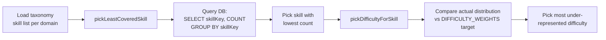

**Difficulty weight targets:**

| Mode | d1 | d2 | d3 | d4 | d5 | d6 | d7 |
|------|----|----|----|----|----|----|-----|
| DRILL (current) | 0 | 5 | 10 | 20 | 25 | 25 | 15 |
| TEST (planned #62) | 0 | 8 | 15 | 27 | 27 | 15 | 6 |
| DIAGNOSTIC (planned #62) | 0 | 0 | 25 | 50 | 25 | 0 | 0 |

#### Diagram Probability by Domain

| Domain | Has Diagram | Diagram Type |
|--------|-------------|--------------|
| geometry_trigonometry | 100% | svg_programmatic |
| problem_solving_data | 70% | chartjs (scatter/bar/histogram) |
| algebra | 25% | svg_programmatic (coordinate plane) |
| advanced_math | 20% | svg_programmatic |
| information_ideas | conditional | chartjs (command_evidence_quantitative only) |
| standard_english / craft_structure | 0% | — |

#### Duplicate Prevention

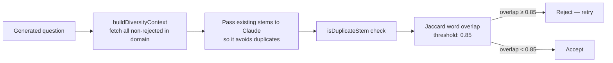

#### Artifact Detection

Rejects questions containing stream-of-consciousness phrases:
`"wait,"` · `"let me recalculate"` · `"actually,"` · `"hmm,"` · `"I need to"` · `"let me re-"` · `"oops"` · `"I made an error"` · `"let me redo"`

Rejected on attempt 1 and 2. Accepted on attempt 3 (final) if no other failures.

#### Question ID Format

```
MATH-ALG-031    →   section=math, domain=algebra, sequence=031
MATH-GEO-015    →   section=math, domain=geometry_trigonometry, sequence=015
RW-SE-008       →   section=reading_writing, domain=standard_english, sequence=008
```

---

### Stage 2 — Render Normalize

**Entry point:** `RenderNormalizeStage.java`
**Purpose:** Fix inconsistent LaTeX delimiters generated by Claude.

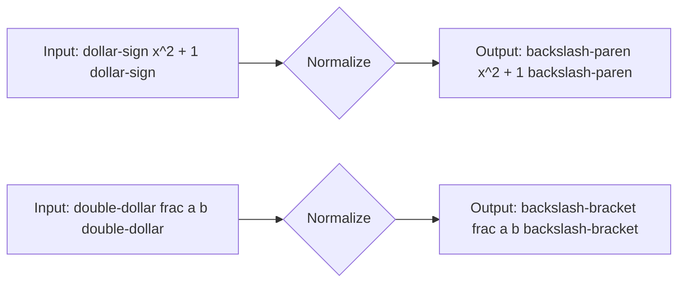

Flags: `--all` (check all statuses), `--dry-run` (report without writing), `--id` (single question).

---

### Stage 3 — Agent Review

**Entry point:** `AgentReviewStage.java`
**Model:** `claude-opus-4-5` | max_tokens: 1200

#### Review Decision Tree

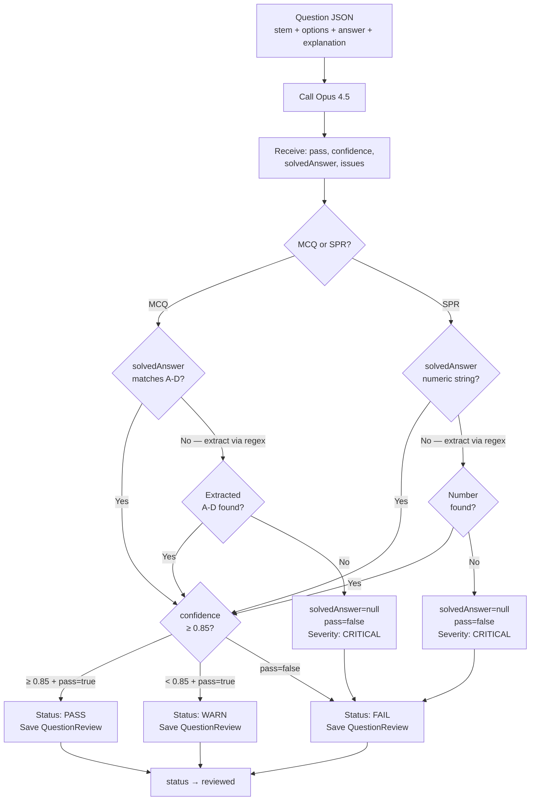

**Issue severity levels:**

| Severity | Meaning | Example |
|----------|---------|---------|
| `critical` | Answer extraction failed or factually wrong | Invalid solvedAnswer format |
| `warning` | Borderline quality issue | Distractor too obviously wrong |
| `info` | Minor note | Phrasing could be clearer |

**CLI flags:**
```bash
--job=agent-review                          # Review all generated questions
--job=agent-review --only-failed            # Re-review pass=false questions
--job=agent-review --domain=algebra         # Filter by domain
--job=agent-review --section=math           # Filter by section
```

---

### Stage 4 — Enrich

**Entry point:** `EnrichStage.java`
**Model:** `claude-opus-4-6` (newest, highest capability) | max_tokens: 3500

#### Enrichment Decision Flow

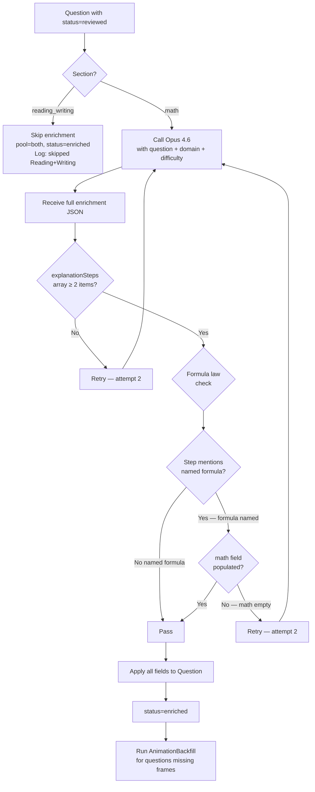

**Formula law trigger keywords:** `quadratic formula` · `pythagorean theorem` · `law of sines` · `law of cosines` · `distance formula` · `midpoint formula` · `slope formula` · `standard form` · `vertex form` · `completing the square` · `FOIL` · `product rule` · `chain rule` · `power rule` · (25+ total)

#### Fields populated by Enrich stage

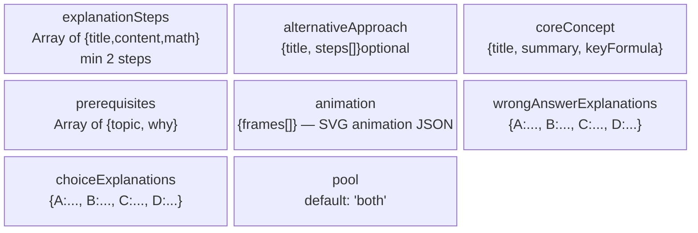

**CLI flags:**
```bash
--job=enrich                         # Enrich all reviewed questions
--job=enrich --section=math          # Math only
--job=enrich --domain=algebra        # Domain filter
--job=enrich --include-approved      # Re-enrich already approved questions
--job=enrich --id=MATH-GEO-010       # Single question by externalId
```

---

### Stage 5 — Visual Check

**Entry point:** `VisualCheckStage.java`
**Scope:** Geometry questions only (domain=geometry_trigonometry)

Validates SVG diagram config — checks for missing required fields, invalid coordinates, out-of-bounds labels. With `--fix` flag, auto-patches known fixable issues (e.g., label coordinates outside viewbox).

---

### Stage 6 — Human Review (validate.html)

**Location:** `src/main/resources/static/admin/validate.html`

Admin UI served at `/admin/validate.html`. Renders each question with full KaTeX + SVG + Chart.js. Admin clicks Approve or Reject per question. Approved questions get `status=approved` and become live to students.

---

## PipelineRunner — CLI Routing

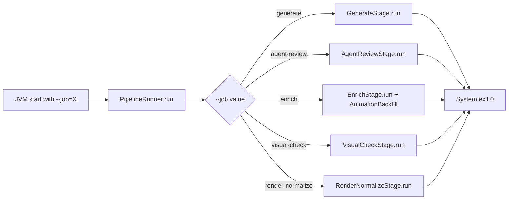

When `--job` flag is absent → `WebApplicationType.NONE` is NOT set → Spring Boot starts normally as a web server.

---

## Claude Client Architecture

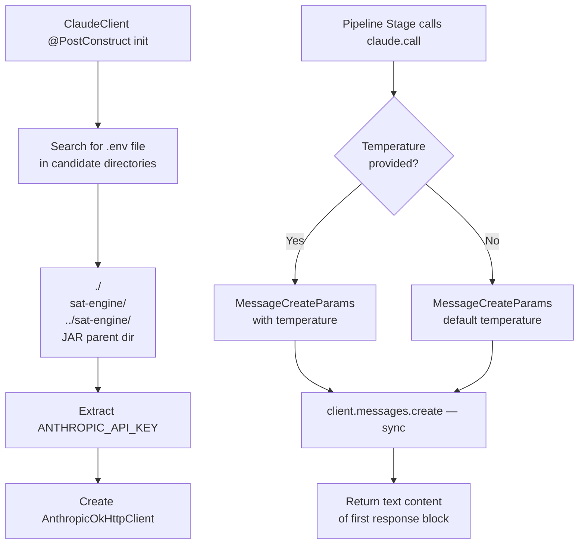

**Model assignments by stage:**

| Stage | Model | Reason |
|-------|-------|--------|
| GenerateStage | `claude-haiku-4-5-20251001` | High volume, cost-sensitive |
| AgentReviewStage | `claude-opus-4-5` | Answer validation needs accuracy |
| EnrichStage | `claude-opus-4-6` | Complex pedagogical content |
| GapAnalysisService | `claude-haiku-4-5` | Real-time, latency-sensitive |

---

## PromptLibrary — Prompt Overview

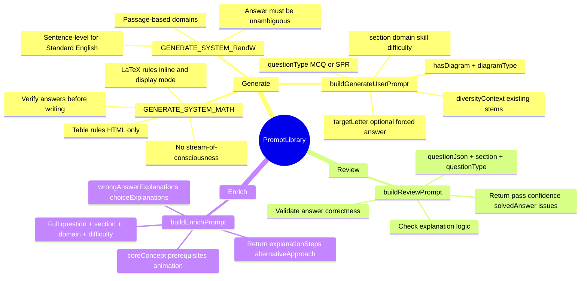

---

## Question Status State Machine

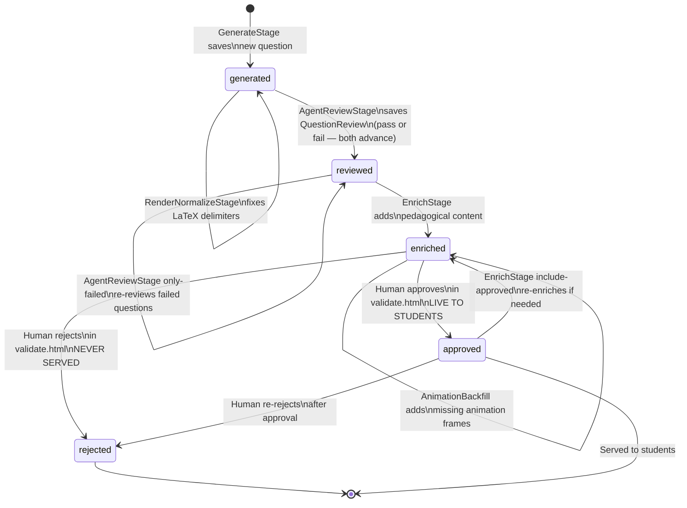

---

## Database Tables — Pipeline Writes

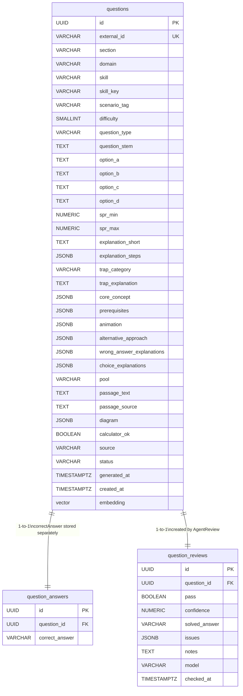

---

## Pipeline Stage × Field Responsibility Matrix

| Field | Generate | Render-Normalize | Agent Review | Enrich | Human Review |
|-------|----------|-----------------|--------------|--------|--------------|
| `externalId` | ✅ | — | — | — | — |
| `section / domain / skill / skillKey` | ✅ | — | — | — | — |
| `difficulty / questionType` | ✅ | — | — | — | — |
| `questionStem / optionA-D` | ✅ | ✅ fixes | — | — | — |
| `explanationShort` | ✅ | — | — | — | — |
| `diagram` | ✅ | — | — | — | — |
| `scenarioTag / calculatorOk` | ✅ | — | — | — | — |
| `pool` | ✅ default=both | — | — | ✅ may update | — |
| `status` | ✅ generated | — | ✅ reviewed | ✅ enriched | ✅ approved/rejected |
| `question_answers.correct_answer` | ✅ | — | — | — | — |
| `question_reviews.*` | — | — | ✅ all fields | — | — |
| `explanationSteps` | — | — | — | ✅ | — |
| `alternativeApproach` | — | — | — | ✅ | — |
| `coreConcept` | — | — | — | ✅ | — |
| `prerequisites` | — | — | — | ✅ | — |
| `animation` | — | — | — | ✅ | — |
| `wrongAnswerExplanations` | — | — | — | ✅ | — |
| `choiceExplanations` | — | — | — | ✅ | — |
| `trapCategory / trapExplanation` | — | — | — | *(planned)* | — |
