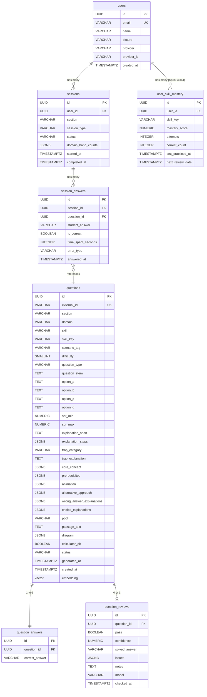
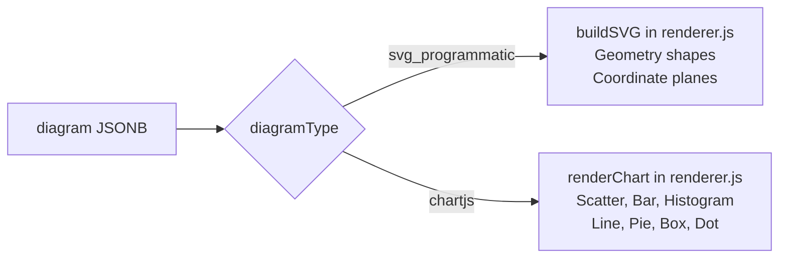
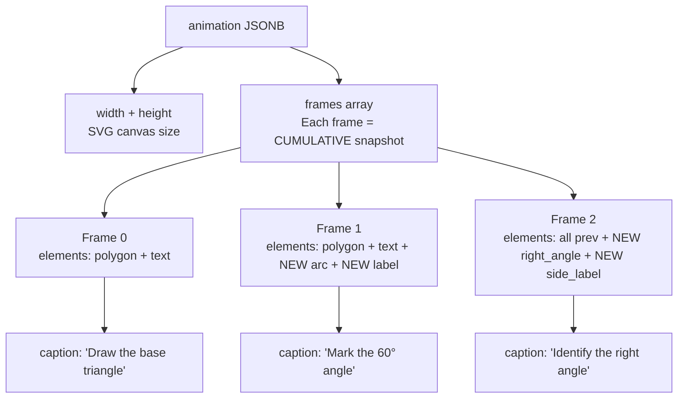
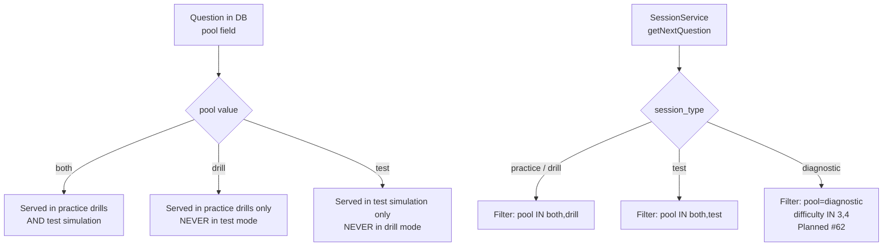
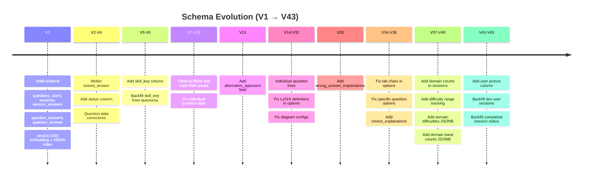

# 19 — Data Model

---

## Overview

The data model is split into two logical areas:
1. **Question Bank** — questions, answers, reviews (populated by pipeline)
2. **Student Activity** — users, sessions, session answers (populated at runtime)

The two areas connect through `skillKey` — every question carries a `skillKey`, and the adaptive engine will use `skillKey` to compute `user_skill_mastery` (Sprint 3, issue #64).

---

## Full Entity Relationship Diagram



---

## Question Entity — Complete Field Reference

### Identity & Classification

| Field | Type | Set By | Example |
|-------|------|--------|---------|
| `id` | UUID | DB auto | `a3f2...` |
| `external_id` | VARCHAR(20) UNIQUE | GenerateStage | `MATH-ALG-031` |
| `section` | VARCHAR(20) | GenerateStage | `math` \| `reading_writing` |
| `domain` | VARCHAR(50) | GenerateStage | `algebra` \| `geometry_trigonometry` |
| `skill` | VARCHAR(100) | GenerateStage | `Linear equations in two variables` |
| `skill_key` | VARCHAR(60) | GenerateStage | `linear_eq_two_var` |
| `scenario_tag` | VARCHAR(60) | GenerateStage | `speed_distance` (prevents duplicate real-world contexts) |
| `difficulty` | SMALLINT 1–7 | GenerateStage | `4` |
| `question_type` | VARCHAR(5) | GenerateStage | `mcq` \| `spr` |
| `calculator_ok` | BOOLEAN | GenerateStage | `true` |
| `source` | VARCHAR(20) | GenerateStage | `ai_generated` |

### Content Fields

| Field | Type | Set By | Notes |
|-------|------|--------|-------|
| `question_stem` | TEXT | GenerateStage | LaTeX: `\(inline\)` or `\[display\]` |
| `option_a` – `option_d` | TEXT | GenerateStage | MCQ only. Null for SPR. |
| `spr_min` / `spr_max` | NUMERIC | GenerateStage | SPR only. Accepted answer range. |
| `explanation_short` | TEXT | GenerateStage | 1–2 sentence solution summary |
| `passage_text` | TEXT | GenerateStage | R&W only. The reading passage. |
| `passage_source` | TEXT | GenerateStage | Citation for R&W passage |
| `diagram` | JSONB | GenerateStage | SVG or Chart.js config (see Diagram Schema below) |
| `trap_category` | VARCHAR(30) | *(planned EnrichStage)* | `formula_confusion` \| `context_misread` \| ... |
| `trap_explanation` | TEXT | *(planned EnrichStage)* | Why students commonly miss this |

### Enrichment Fields (set by EnrichStage)

| Field | Type | JSONB Schema |
|-------|------|--------------|
| `explanation_steps` | JSONB | `[{title, content, math}]` — min 2 steps |
| `alternative_approach` | JSONB | `{title, steps:[{title,content,math}]}` |
| `core_concept` | JSONB | `{title, summary, keyFormula}` |
| `prerequisites` | JSONB | `[{topic, why}]` |
| `animation` | JSONB | `{frames:[{elements:[],caption}]}` — see Animation Schema |
| `wrong_answer_explanations` | JSONB | `{A:"...", B:"...", C:"...", D:"..."}` |
| `choice_explanations` | JSONB | `{A:"...", B:"...", C:"...", D:"..."}` |

### Pool & Status

| Field | Type | Values |
|-------|------|--------|
| `pool` | VARCHAR(10) | `both` (default) · `drill` · `test` · *(planned)* |
| `status` | VARCHAR(20) | `generated` → `reviewed` → `enriched` → `approved` / `rejected` |

---

## JSONB Schemas

### diagram (set by GenerateStage)

Two diagram types. The `diagramType` field in the outer object determines routing in `renderer.js`:



**svg_programmatic examples:**

```json
{
  "diagramType": "svg_programmatic",
  "shape": "triangle",
  "vertices": {"A": [50, 180], "B": [230, 180], "C": [140, 30]},
  "sides": {"AB": "12", "BC": "13", "CA": "5"},
  "angles": {"A": "67°", "B": "23°", "C": "90°"},
  "angleMarkers": ["C"],
  "width": 280,
  "height": 220
}
```

**svg_programmatic shape types:**

| Shape | Key fields |
|-------|-----------|
| `triangle` | vertices, sides, angles, angleMarkers |
| `circle` | cx, cy, r, sectors, chords, radiusLabel |
| `coordinate_plane` | xRange, yRange, functions[], points[], inequalities[] |
| `normal_curve` | mean, sd, shadedRegions[] |
| `venn_diagram` | sets[], intersections[] |
| `3d_shape` | shape (prism/pyramid/cylinder), dimensions |
| `parallel_transversal` | lineCount, transversals, angleLabels |
| `composite` | shapes[] (array of sub-shapes) |

**chartjs examples:**

```json
{
  "diagramType": "chartjs",
  "chartType": "scatter",
  "data": {"datasets": [{"label": "Data", "data": [{"x":1,"y":2},...]}]},
  "options": {"scales": {"x": {"title": {"text": "Time (hours)"}}}},
  "width": 300,
  "height": 250
}
```

**chartjs chart types:** `scatter` · `bar` · `histogram` · `line` · `pie` · `boxplot` · `dotplot`

---

### animation (set by EnrichStage)



**Key rule: each frame is cumulative** — Frame N contains all elements from frames 0..N-1 PLUS new elements for frame N. The renderer detects new elements by comparing `elements.length` of frame N vs frame N-1.

**Element types inside frames:**

| Type | Required fields | Animation class |
|------|----------------|-----------------|
| `polygon` | points, stroke, fill | `.anim-draw` (stroke draw) |
| `line` | x1,y1,x2,y2, stroke | `.anim-draw` |
| `circle` | cx,cy,r, stroke,fill | `.anim-draw` |
| `arc` | cx,cy,r, startDeg,endDeg, label | `.anim-draw` |
| `sector` | cx,cy,r, startDeg,endDeg, fill | `.anim-fade` |
| `rect` | x,y,width,height, stroke,fill | `.anim-draw` |
| `right_angle` | vertex,leg1,leg2, size,stroke | `.anim-fade` |
| `dot` | x,y,r,fill | `.anim-fade` |
| `side_label` | p1,p2, awayFrom,text, offset | `.anim-fade` |
| `text` | x,y,text, fontSize,anchor | `.anim-fade` |
| `katex` | x,y,formula,fontSize | DOM overlay (skipped in synced mode) |

**Full animation JSON example:**
```json
{
  "width": 280,
  "height": 260,
  "frames": [
    {
      "elements": [
        {"type":"polygon","points":[[50,200],[230,200],[140,40]],"stroke":"#334155","strokeWidth":2,"fill":"#f1f5f9"}
      ],
      "caption": "Draw a triangle with vertices A, B, C"
    },
    {
      "elements": [
        {"type":"polygon","points":[[50,200],[230,200],[140,40]],"stroke":"#334155","strokeWidth":2,"fill":"#f1f5f9"},
        {"type":"arc","cx":50,"cy":200,"r":22,"startDeg":-20,"endDeg":30,"label":"30°","labelSize":12,"labelColor":"#1e40af"},
        {"type":"side_label","p1":[50,200],"p2":[230,200],"awayFrom":[140,40],"text":"12","offset":16,"fontSize":13}
      ],
      "caption": "Label the 30° angle and the base = 12"
    }
  ]
}
```

---

### explanation_steps (set by EnrichStage)

```json
[
  {
    "title": "Set up the ratio",
    "content": "In a 30-60-90 triangle, sides follow the ratio \\(1 : \\sqrt{3} : 2\\). The hypotenuse corresponds to 2.",
    "math": "\\text{scale factor} = \\frac{10}{2} = 5"
  },
  {
    "title": "Find the short leg",
    "content": "The short leg (opposite 30°) corresponds to 1 in the ratio.",
    "math": "\\text{short leg} = 1 \\times 5 = 5"
  },
  {
    "title": "Find the long leg",
    "content": "The long leg (opposite 60°) corresponds to \\(\\sqrt{3}\\) in the ratio.",
    "math": "\\text{long leg} = \\sqrt{3} \\times 5 = 5\\sqrt{3}"
  }
]
```

---

### core_concept (set by EnrichStage)

```json
{
  "title": "Special Right Triangle Ratios",
  "summary": "Two special right triangles appear frequently on the SAT. The 30-60-90 triangle has side ratio \\(1 : \\sqrt{3} : 2\\), and the 45-45-90 triangle has ratio \\(1 : 1 : \\sqrt{2}\\). Memorizing these eliminates the need for trigonometry.",
  "keyFormula": "30\\text{-}60\\text{-}90: \\; x : x\\sqrt{3} : 2x"
}
```

---

## Session & Answer Model

### Session Entity

| Field | Type | Values / Notes |
|-------|------|----------------|
| `id` | UUID | PK |
| `user_id` | UUID FK | References users |
| `section` | VARCHAR | `math` \| `reading_writing` \| `mixed` |
| `session_type` | VARCHAR | `practice` · `diagnostic` *(planned)* · `drill` *(planned)* · `test` *(planned)* · `foundations` *(planned)* |
| `status` | VARCHAR | `in_progress` \| `completed` \| `abandoned` |
| `domain_band_counts` | JSONB | Quota map: `{"algebra":{"easy":2,"medium":5}}` |
| `started_at` | TIMESTAMPTZ | Session creation time |
| `completed_at` | TIMESTAMPTZ | When student submits last answer |

### session_answers Entity

| Field | Type | Notes |
|-------|------|-------|
| `id` | UUID | PK |
| `session_id` | UUID FK | References sessions |
| `question_id` | UUID FK | References questions |
| `student_answer` | VARCHAR | Letter (MCQ) or numeric string (SPR) |
| `is_correct` | BOOLEAN | Computed at submission against question_answers |
| `time_spent_seconds` | INTEGER | Client-side timer, sent on submit |
| `error_type` | VARCHAR | `CONCEPT` · `APPLICATION` · `SETUP` · `CARELESS` — *(planned #72, #89)* |
| `answered_at` | TIMESTAMPTZ | Server timestamp |

---

## Planned Tables (not yet migrated)

### user_skill_mastery (Sprint 3, issue #64)

```sql
CREATE TABLE user_skill_mastery (
    id               UUID PRIMARY KEY DEFAULT gen_random_uuid(),
    user_id          UUID NOT NULL REFERENCES users(id) ON DELETE CASCADE,
    skill_key        VARCHAR(60) NOT NULL,
    mastery_score    NUMERIC(4,3) DEFAULT 0.0,  -- 0.000 to 1.000
    attempts         INTEGER DEFAULT 0,
    correct_count    INTEGER DEFAULT 0,
    last_practiced_at TIMESTAMPTZ,
    next_review_date  DATE,  -- for spaced repetition (#85)
    UNIQUE (user_id, skill_key)
);
```

**Mastery score formula (recency-weighted):**

```
masteryScore = Σ(result_i × 0.8^position_i) / Σ(0.8^position_i)

Where:
  result_i  = 1 (correct) or 0 (wrong)
  position_i = 0 for most recent, 1 for second most recent, ...
  Capped at last 20 attempts
  0.8^0 = 1.00  (most recent has full weight)
  0.8^1 = 0.80
  0.8^2 = 0.64
  0.8^5 = 0.33
  0.8^9 = 0.13  (10th most recent has little weight)
```

**Mastery thresholds:**

| Level | masteryScore | Meaning |
|-------|-------------|---------|
| Weak | < 0.4 | Needs work |
| Developing | 0.4 – 0.6 | Improving |
| Proficient | 0.6 – 0.8 | Getting there |
| Mastered | ≥ 0.8 | Strong — resurface after 7 days (#85) |

---

## Question Pool — Values & Routing



**Current state:** All generated questions default to `pool=both`. Pool reclassification will be added via:
- `--job=generate` with DIAGNOSTIC/TEST mode flag (issue #62)
- Human review UI (validate.html) pool picker

---

## Flyway Migration History



**Next migrations planned:**

| Migration | Issue | What it adds |
|-----------|-------|--------------|
| V44 | #64 | `user_skill_mastery` table |
| V45 | #72 | `error_type` column on `session_answers` |
| V46 | #59/#60/#87 | Prerequisites + poolTarget + hasConceptGuide in taxonomy (JSON file, not DB) |

---

## Indexes

```sql
-- questions table
CREATE INDEX idx_questions_section    ON questions(section);
CREATE INDEX idx_questions_domain     ON questions(domain);
CREATE INDEX idx_questions_pool       ON questions(pool);
CREATE INDEX idx_questions_difficulty ON questions(difficulty);
CREATE INDEX idx_questions_status     ON questions(status);
CREATE INDEX idx_questions_skill_key  ON questions(skill_key);

-- Vector similarity (HNSW — unused until embedding pipeline enabled)
CREATE INDEX idx_questions_embedding
    ON questions USING hnsw (embedding vector_cosine_ops)
    WITH (m=16, ef_construction=64);

-- sessions + session_answers
CREATE INDEX idx_sessions_user_id           ON sessions(user_id);
CREATE INDEX idx_session_answers_session_id ON session_answers(session_id);
CREATE INDEX idx_session_answers_question_id ON session_answers(question_id);

-- Planned (Sprint 3)
CREATE INDEX idx_user_skill_mastery_user_id  ON user_skill_mastery(user_id);
CREATE INDEX idx_user_skill_mastery_skill_key ON user_skill_mastery(skill_key);
```
