# 20 — Frontend Architecture

---

## Overview

The frontend is a **React 19 + Vite SPA** served as static files by Spring Boot. It communicates with the backend exclusively via REST API calls. All math rendering (KaTeX), diagram rendering (SVG + Chart.js), and animation playback (custom renderer.js) happen client-side.

---

## Technology Stack

| Library | Version | Purpose |
|---------|---------|---------|
| React | 19.2.4 | UI framework |
| React Router | 7.14.0 | Client-side routing |
| Axios | 1.14.0 | HTTP client |
| KaTeX | 0.16.45 | LaTeX math rendering |
| lucide-react | 1.8.0 | Icons |
| renderer.js | custom | SVG diagrams + Chart.js + animations |
| Sentry | 8.55.0 | Error tracking |

---

## Application Structure

```mermaid
flowchart TD
    A[main.jsx\nReact root mount] --> B[App.jsx\nRoutes + AuthContext]
    B --> C[RequireAuth\nredirects to /login if no session]
    B --> D[/login\nlogin.html Spring-served]

    C --> E[AppShell\nNavbar + Sidebar layout]
    E --> F[/\nHomePage]
    E --> G[/dashboard\nDashboardPage]
    E --> H[/practice\nPracticeSetupPage]
    E --> I[/session/:id\nPracticeSession flow]
    E --> J[/session/:id/summary\nSummaryPage]
    E --> K[/session/:id/review/:idx\nReviewPage]
    E --> L[/history\nHistoryPage]
    E --> M[/skill/:key\nSkillPage]
```

---

## Page Inventory

| Page | Route | Purpose |
|------|-------|---------|
| `HomePage` | `/` | Landing / quick start |
| `DashboardPage` | `/dashboard` | Stats, domain accuracy, recent sessions |
| `PracticeSetupPage` | `/practice` | Configure session (section, domain, difficulty) |
| `PracticePage` | `/session/:id` | Live question answering with QuestionCard + FeedbackPanel |
| `SummaryPage` | `/session/:id/summary` | End-of-session results, accuracy by skill |
| `ReviewPage` | `/session/:id/review/:idx` | Per-question review after session |
| `HistoryPage` | `/history` | All past sessions list |
| `SkillPage` | `/skill/:key` | Deep-dive on one skill |
| `DashboardPage` | `/dashboard` | Progress overview |

---

## Component Hierarchy — Practice Flow

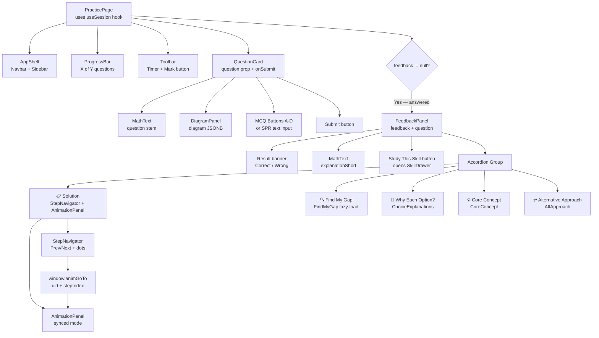

---

## KaTeX Rendering — Architecture

### Two Rendering Paths

```mermaid
flowchart TD
    subgraph PATH1["Path 1 — MathText Component (primary)"]
        A[text prop passed to MathText] --> B[applyKatex function]
        B --> C[Split by regex:\n\\[...\\] display\n\\(...\\) inline\n$ ... $ smart filter]
        C --> D{Segment type}
        D -->|plain text| E[HTML escape\nconvert newlines to br]
        D -->|math segment| F[katex.renderToString\ndisplayMode based on delimiter\nthrowOnError: false]
        E --> G[Concatenate HTML string]
        F --> G
        G --> H[dangerouslySetInnerHTML\nReact injects pre-rendered HTML]
    end

    subgraph PATH2["Path 2 — useKaTeX Hook (secondary)"]
        I[ref to DOM element] --> J[useEffect fires]
        J --> K[setTimeout 30ms\nwait for paint]
        K --> L{window.renderMathInElement\nloaded?}
        L -->|Yes| M[renderMathInElement el\ndelimiters \\( \\[ only]
        L -->|No| N[Queue in window._pendingKatex\nprocess when KaTeX loads]
    end
```

### MathText — Dollar Sign Smart Filter

The `isMathContent(inner)` function prevents currency amounts like `$50` from being rendered as math:

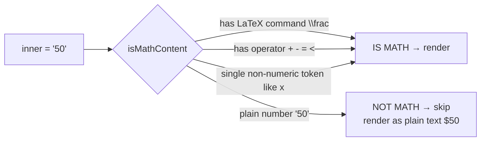

### Supported Delimiters

| Delimiter | Mode | Path |
|-----------|------|------|
| `\[...\]` | Display (block) | Both Path 1 and Path 2 |
| `\(...\)` | Inline | Both Path 1 and Path 2 |
| `$...$` | Inline | Path 1 only (with smart filter) |

### KaTeX Options

```javascript
katex.renderToString(expr, {
  displayMode: isDisplay,   // true for \[...\], false for \(...\)
  throwOnError: false,      // broken math → escaped text fallback, never crashes
  trust: false              // no raw HTML injection
})
```

---

## Diagram Rendering — Architecture

### renderer.js Dispatch Flow

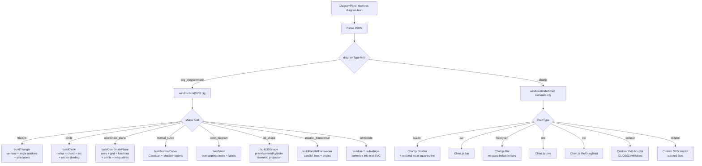

### Coordinate System Transformation

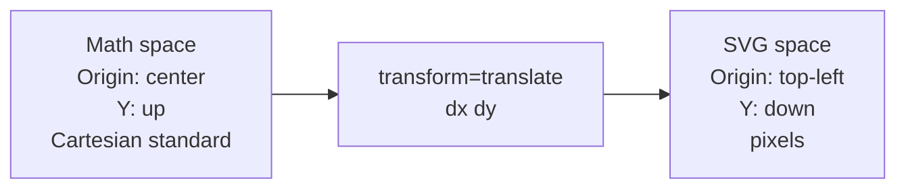

All geometry shapes use this transform. Math coordinates passed in JSON are converted to SVG pixel space automatically by `autoCenterTransform()`.

### SVG Utility Functions (renderer.js)

| Function | Purpose |
|----------|---------|
| `svgWrap(w, h, inner)` | Creates `<svg viewBox="0 0 w h">` wrapper |
| `autoCenterTransform(points, w, h)` | Computes translate to center shape in canvas |
| `svgText(x, y, text, opts)` | Creates `<text>` with styling |
| `arrowHead(x1,y1,x2,y2,color)` | Polygon arrowhead at line end |
| `rightAngleSquare(vx,vy,ax,ay,bx,by)` | Right-angle square marker |
| `clampLabel(x, y, w, h, padding)` | Keeps label inside canvas bounds |
| `midpoint(p1, p2)` | Average of two [x,y] points |
| `distance(p1, p2)` | Euclidean distance |

### Chart.js Cleanup Rule

**Critical:** Chart.js cannot reuse a canvas that already has a chart instance. Before rendering a new chart:

```javascript
// Always destroy existing instance before re-render
const existing = Chart.getChart(canvasEl)
if (existing) existing.destroy()
// Then create new instance
new Chart(canvasEl, config)
```

This is handled inside `renderChart()` in renderer.js.

---

## Animation System — Architecture

### Full Animation Flow

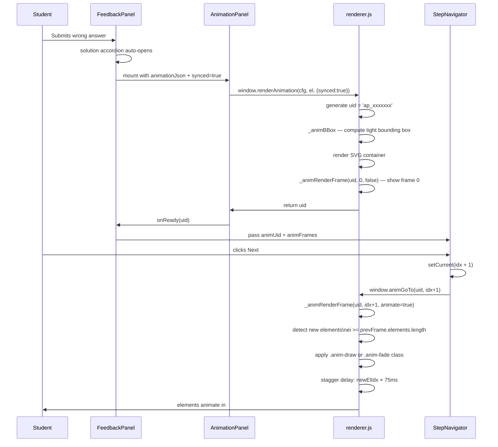

### Frame Rendering — New Element Detection

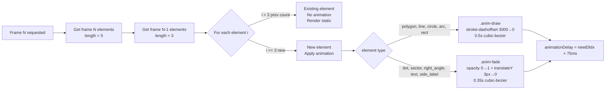

### Animation CSS Keyframes

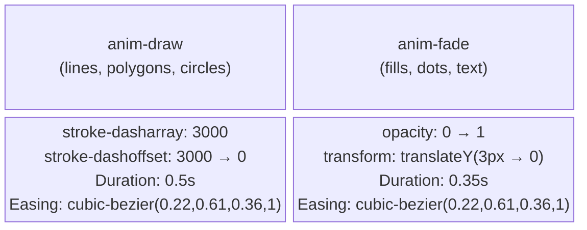

### Synced vs Standalone Mode

| Mode | Controls | KaTeX overlays | Use case |
|------|----------|----------------|----------|
| `synced=true` | None (hidden) | Skipped (formula in step text) | FeedbackPanel — synced with StepNavigator |
| `synced=false` (default) | Prev/Next + dots built-in | Shown as positioned overlays | Standalone animation player |

### Global Animation Registry

```javascript
window._animPlayers = {
  'ap_abc123': {
    cfg: { width, height, frames },
    currentIdx: 2,
    svgEl: <SVGElement>,
    ovEl: <div>,     // overlay container for katex labels
    synced: true
  }
}
```

`window.animGoTo(uid, idx)` looks up the player by uid and calls `_animRenderFrame()`. This global registry is how the decoupled StepNavigator controls the AnimationPanel without prop drilling.

---

## FeedbackPanel — Accordion Structure

```mermaid
flowchart TD
    A[FeedbackPanel mounts] --> B[Result Banner\nGreen ✓ or Red ✗]
    B --> C[Short explanation\nMathText]
    C --> D[Study This Skill button\nopens SkillDrawer overlay]
    D --> E[Accordion Group]

    E --> F{📋 Solution}
    F -->|Auto-opens| G{hasAnimation?}
    G -->|Yes| H[Split pane:\nAnimationPanel left\nStepNavigator right]
    G -->|No| I[StepNavigator only\nfull width]

    E --> J{🔍 Find My Gap}
    J -->|Wrong answers only\nLazy loads on open| K[API: POST /api/gap/analyze\nquestionId + studentAnswer]
    K --> L[GapCard pills + active card\ntrigger + title + body + example + takeaway]

    E --> M{💬 Why Each Option?}
    M -->|MCQ only\nchoiceExplanations exists| N[Letters A-D with\ncorrect green / wrong red\nMathText per choice]

    E --> O{💡 Core Concept}
    O --> P[title + summary + keyFormula\nMathText rendering]

    E --> Q{⇄ Alternative Approach}
    Q --> R[title + steps[]\nSame step format as Solution]
```

### Keyboard Navigation

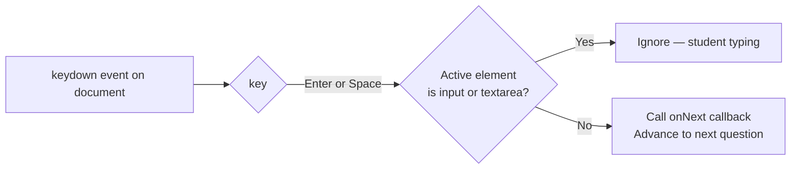

---

## SkillDrawer — Skill Content Display

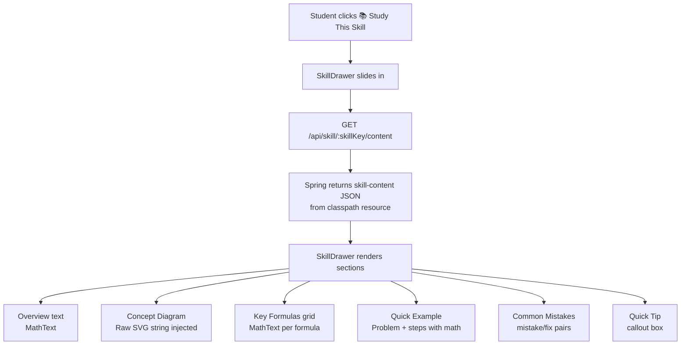

### skill-content JSON Schema (existing format)

```json
{
  "skillKey": "special_right_triangles",
  "domain": "geometry_trigonometry",
  "label": "Special Right Triangles",
  "overview": "Text description...",

  "conceptDiagram": {
    "caption": "30-60-90 and 45-45-90 side ratios",
    "svg": "<svg xmlns='...'> raw SVG string </svg>"
  },

  "keyFormulas": [
    {
      "name": "45-45-90 sides",
      "latex": "1 : 1 : \\sqrt{2} \\quad (\\text{hyp} = \\text{leg} \\times \\sqrt{2})"
    }
  ],

  "workedExamples": [
    {
      "problem": "The hypotenuse is 10. Find both legs.",
      "steps": [
        {
          "title": "Apply the 1:√3:2 ratio",
          "content": "Scale factor = 10/2 = 5",
          "math": "\\text{short leg} = 5, \\text{long leg} = 5\\sqrt{3}"
        }
      ]
    }
  ],

  "commonMistakes": [
    {
      "mistake": "Mixing up which side is opposite 30° vs 60°",
      "fix": "Short leg is ALWAYS opposite the smallest angle (30°)"
    }
  ],

  "quickTip": "Find the scale factor first by matching hypotenuse to 2x."
}
```

**44 skill-content files exist** in `src/main/resources/skill-content/`. Served via `SkillContentController` at `GET /api/skill/{skillKey}/content`. Security: only `[a-z0-9_]{1,60}` keys accepted — path traversal protection.

---

## API Communication Layer

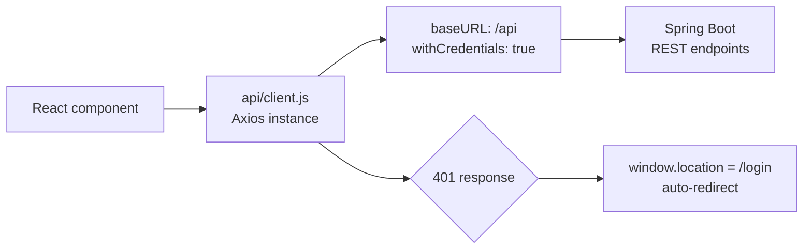

### Key API Endpoints (current)

| Method | Path | Purpose |
|--------|------|---------|
| GET | `/api/dashboard` | Dashboard stats + domain accuracy |
| POST | `/api/sessions` | Create new session |
| GET | `/api/sessions/:id/next` | Get next question in session |
| POST | `/api/sessions/:id/answers` | Submit answer + get feedback |
| GET | `/api/sessions/:id/answers` | Get all answers for session (review) |
| GET | `/api/sessions/:id` | Get session details |
| POST | `/api/gap/analyze` | Find My Gap — Claude gap analysis |
| GET | `/api/skill/:key/content` | Skill content JSON for SkillDrawer |

### Planned API Endpoints (adaptive engine)

| Method | Path | Issue | Purpose |
|--------|------|-------|---------|
| POST | `/api/sessions/diagnostic` | #65 | Start two-stage diagnostic |
| GET | `/api/skill-map` | #66 | Get skill map with confidence levels |
| POST | `/api/sessions/drill` | #69 | Start drill with prereq check |
| GET | `/api/sessions/difficulty` | #70 | Rolling 4Q difficulty adjustment |
| POST | `/api/sessions/foundations` | #71 | Start foundations micro-lesson |

---

## Authentication Flow

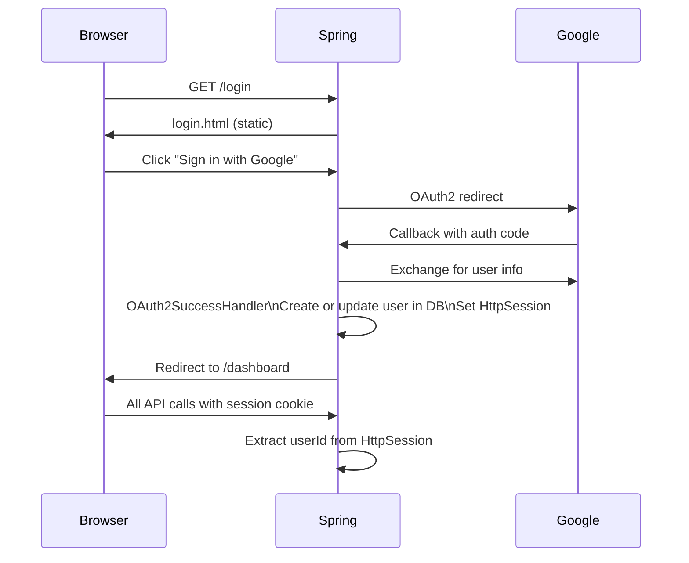

**Dev login** (`DevLoginController`) bypasses OAuth for local development.

---

## DashboardPage — Data Flow

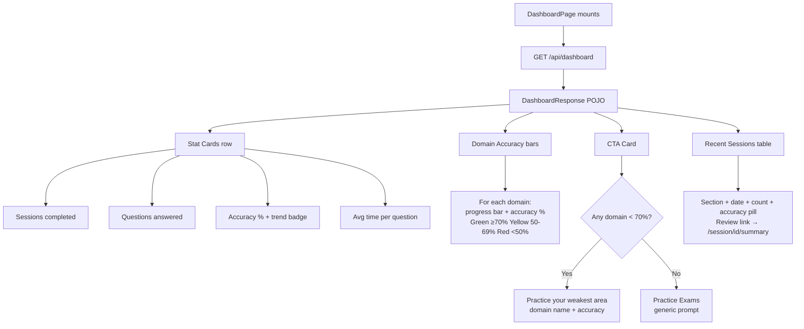

### Trend Badge Logic

```javascript
// Compare second half of trend to first half
const mid = Math.floor(trend.length / 2)
const firstHalf = trend.slice(0, mid).reduce((a,b)=>a+b,0) / mid
const secondHalf = trend.slice(mid).reduce((a,b)=>a+b,0) / (trend.length - mid)
const delta = secondHalf - firstHalf

if (delta > 2)  return '↑ Improving'
if (delta < -2) return '↓ Declining'
return '→ Steady'
```

---

## SummaryPage — Dual Mode

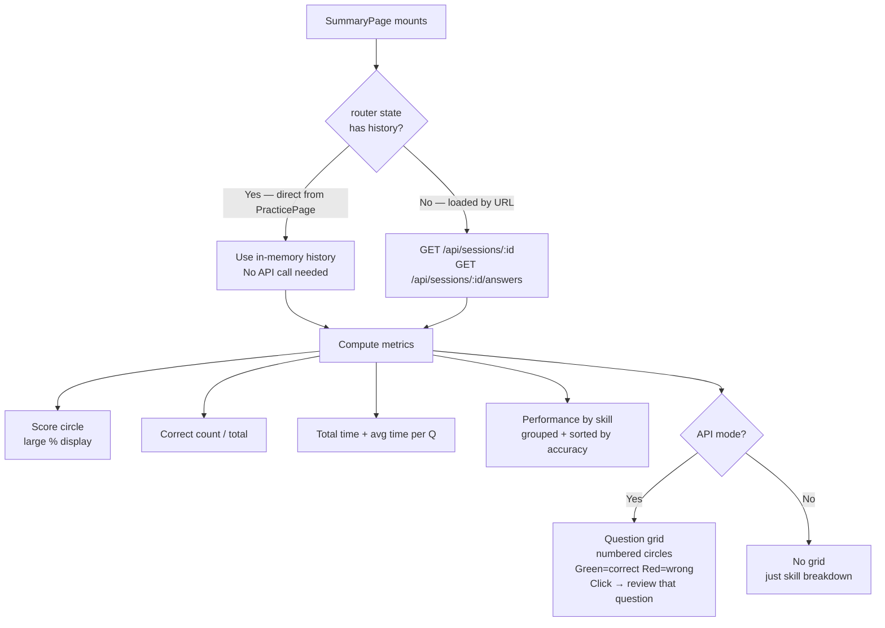

---

## React Hooks

| Hook | File | Purpose |
|------|------|---------|
| `useSession` | `hooks/useSession.js` | Session lifecycle (create, next Q, submit) |
| `usePracticeSession` | `hooks/usePracticeSession.js` | Practice page state machine |
| `useTimer` | `hooks/useTimer.js` | Per-question timer (counts up, freezes on submit) |
| `useKaTeX` | `hooks/useKaTeX.js` | Auto-render KaTeX in existing DOM elements |
| `useAuth` (context) | `context/AuthContext.jsx` | Current user + auth state |

---

## Build & Deployment

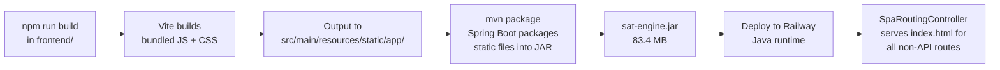

**Dev mode:** `npm run dev` in `frontend/` runs Vite dev server on port 5173 with proxy to Spring Boot on port 8080.

**Skip frontend build** (CI/Docker): `mvn package -Dskip.frontend=true`

---

## Error Handling

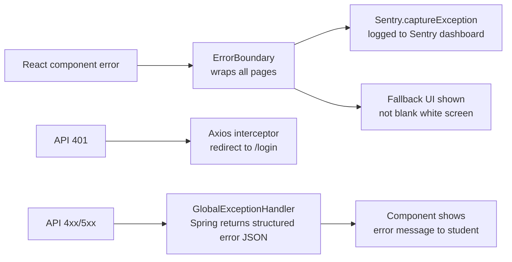
