# 21 — Deployment Architecture

---

## Overview

SatEngine is a **monolithic Spring Boot + React SPA** deployed on Railway with Supabase as the production database. There is no CI/CD pipeline — deployment is manual via Railway watching the GitHub repository.

---

## Infrastructure Stack

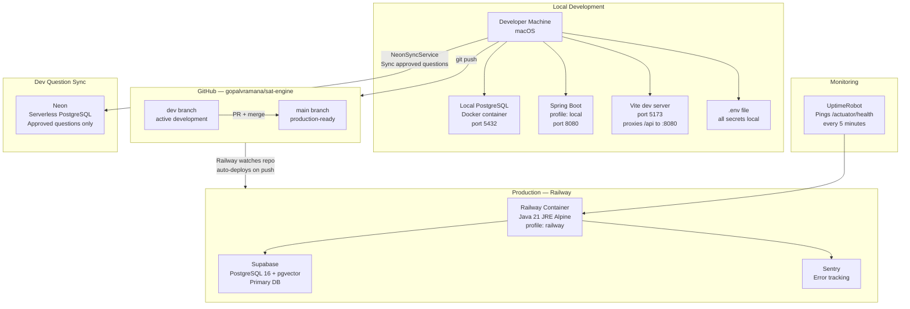

---

## Branch Strategy

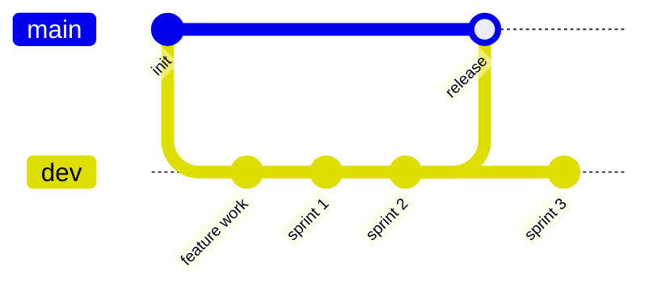

| Branch | Purpose | Railway deploys from |
|--------|---------|---------------------|
| `main` | Production-ready code | Yes (configured in Railway) |
| `dev` | Active development | Optional staging deploy |

**No GitHub Actions CI/CD** — no `.github/workflows/` directory. All deployments are triggered by Railway watching the GitHub repository. Tests run locally only.

---

## Deployment Flow — Step by Step

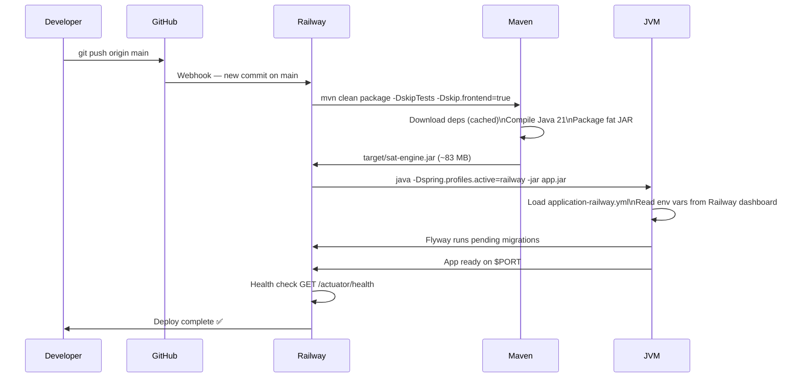

**Docker build (alternative path):**

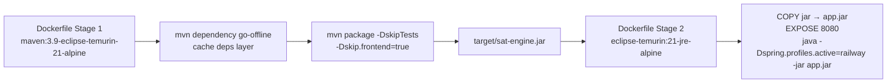

**Why `-Dskip.frontend=true`:** The React frontend is pre-built locally (`npm run build`) and committed to `src/main/resources/static/app/`. Docker and Railway skip the Node/npm/Vite build entirely — saving 5–10 minutes per deploy.

---

## Spring Boot Profiles

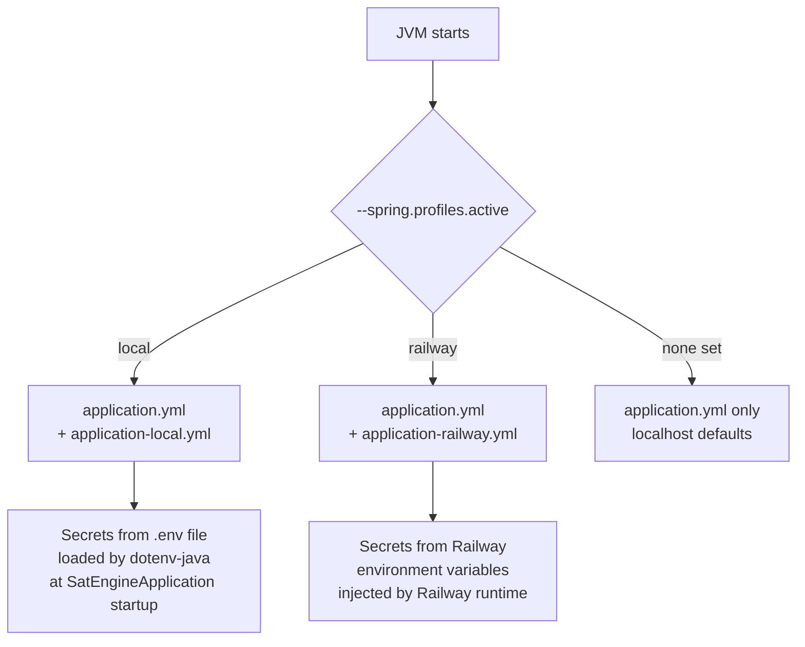

### Profile Comparison

| Config | `local` | `railway` |
|--------|---------|-----------|
| Database | `localhost:5432/satengine` | `$DB_URL` (Supabase) |
| DB credentials | `.env` file | Railway dashboard vars |
| Google OAuth2 | Disabled (DevLoginController) | `$GOOGLE_CLIENT_ID` + `$GOOGLE_CLIENT_SECRET` |
| Connection pool max | Default (10) | 3 connections (small container) |
| Connection pool min-idle | Default | 1 |
| Keep-alive | Default | 60s |
| Max lifetime | Default | 300s (5 min) |
| Server port | 8080 | `$PORT` (Railway sets) |
| HTTPS | None (localhost) | Auto-provisioned by Railway |
| X-Forwarded-Proto | Not set | `forward-headers-strategy: framework` |
| Neon sync | Available | Disabled (NEON_SYNC_URL blank) |
| Sentry | Off (DSN blank) | On (`$SENTRY_DSN` set) |
| Frontend | Vite dev server :5173 | Static files from JAR |

---

## All Environment Variables

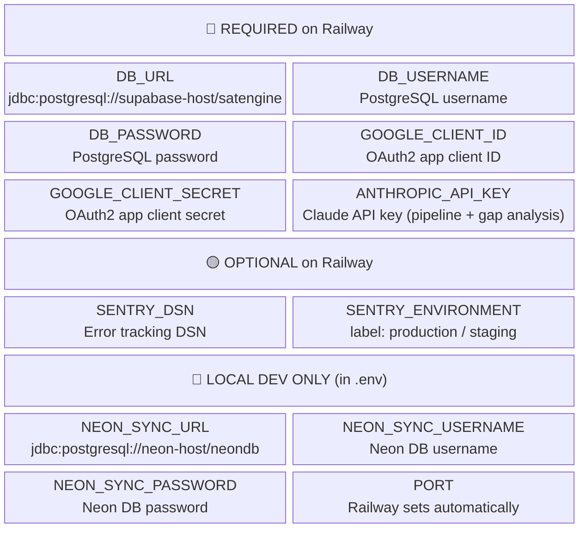

### `.env.example` (local dev template)

```bash
DB_URL=jdbc:postgresql://localhost:5432/satengine
DB_USERNAME=postgres
DB_PASSWORD=yourpassword

ANTHROPIC_API_KEY=sk-ant-...

# Neon sync (local dev only — sync approved questions to Neon)
NEON_SYNC_URL=jdbc:postgresql://ep-xxxx.us-east-1.aws.neon.tech/neondb?sslmode=require
NEON_SYNC_USERNAME=neondb_owner
NEON_SYNC_PASSWORD=your_neon_password
```

---

## What Each Service Does

### Railway — Application Hosting

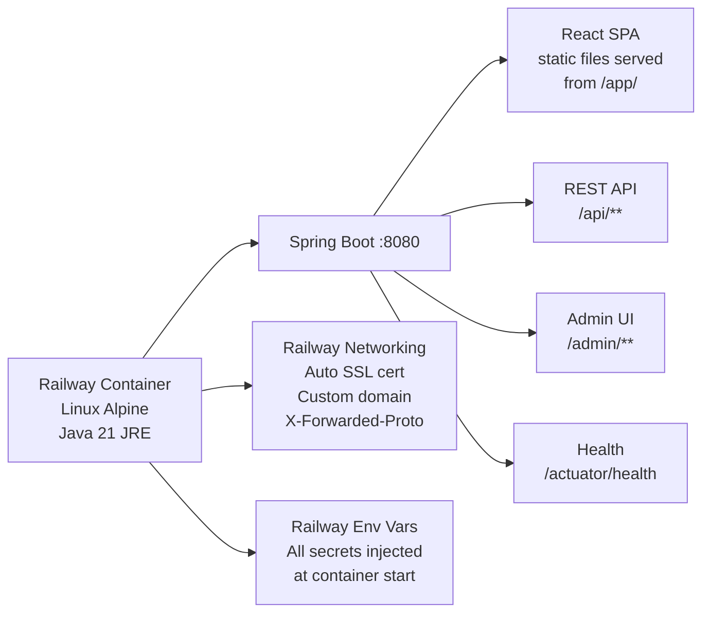

- **Auto-restart:** If `/actuator/health` returns DOWN 3× in a row → container restarts automatically
- **Startup grace:** 60 seconds before health checks begin (Flyway + Spring Boot startup)
- **SSL:** Auto-provisioned — HTTPS enforced for all traffic
- **Port:** Railway sets `$PORT` environment variable; app reads `server.port: ${PORT:8080}`

### Supabase — Production Database

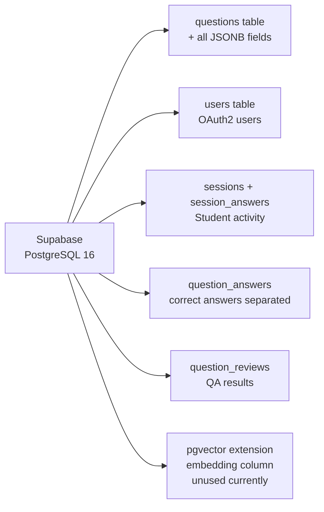

- **What we use:** PostgreSQL database only
- **What we don't use:** Supabase Auth, Realtime, Edge Functions, Storage
- **App handles auth** via Spring Security + Google OAuth2
- **Connection:** HikariCP pool — max 3 connections (Railway free tier limits)
- **Free tier:** 500MB storage (plenty for question bank + student data)
- **Scale path:** $25/month Pro plan

### Neon — Dev Question Sync (local only)

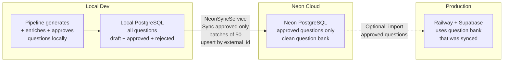

**Why Neon exists:** Local dev DB contains everything including rejected/draft questions. Neon holds only the clean approved question bank. This keeps production clean without needing to carefully filter on every query.

**NeonSyncService syncs:**
- `questions` WHERE `status = 'approved'`
- `question_answers` (joined by `external_id`)
- `question_reviews` (joined by `external_id`)
- Upsert on conflict — idempotent, safe to run multiple times

### Sentry — Error Tracking

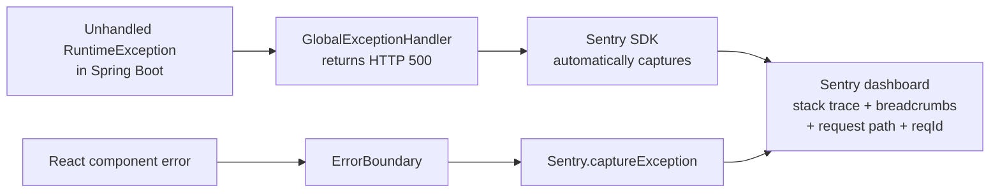

- Spring Boot: all unhandled exceptions at `ERROR` level auto-sent
- React: `@sentry/react` captures component errors via ErrorBoundary
- Breadcrumbs: prior INFO+ logs attached as context to each error
- Environment tag: `SENTRY_ENVIRONMENT=production` separates prod vs staging errors
- Free tier: 5,000 errors/month

### UptimeRobot — Uptime Monitoring

- Pings `GET /actuator/health` every 5 minutes
- Alerts via email/SMS if app goes down
- `show-details: never` in Actuator config — health response is just `{"status":"UP"}` (no credentials leaked)

---

## Observability Stack

```mermaid
flowchart TD
    A[Request arrives] --> B[RequestLoggingFilter\nGenerates reqId\nLogs path + duration]
    B --> C[MDC: reqId=abc123\nAll logs in this request\ncarry this ID]
    C --> D[Application code\nDEBUG logs for satengine.*\nWARN for framework noise]
    D --> E{Error?}
    E -->|RuntimeException| F[GlobalExceptionHandler\nHTTP 500 + structured JSON]
    F --> G[Sentry\nstack trace + reqId\n+ all breadcrumbs]
    E -->|No error| H[Response logged\nwith duration]

    I[/actuator/health] --> J[Returns status: UP/DOWN]
    J --> K[Railway auto-restart on DOWN]
    J --> L[UptimeRobot alert on DOWN]
```

**Log levels (logback-spring.xml):**

| Logger | Level | Reason |
|--------|-------|--------|
| `com.satengine` | DEBUG | Full app visibility |
| `org.springframework.web.servlet.DispatcherServlet` | WARN | Suppress request noise |
| `org.springframework.security` | WARN | Suppress auth noise |
| `org.hibernate.SQL` | WARN | Suppress query noise |
| `org.apache.catalina` | WARN | Suppress Tomcat noise |
| Root | INFO | Everything else |

---

## Frontend Build & Static Serving

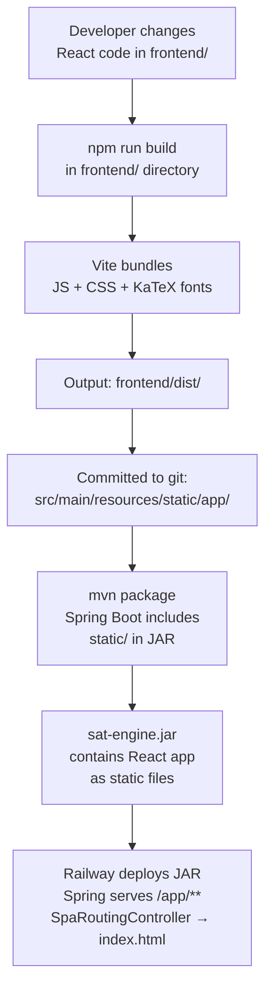

**Dev mode:**
```bash
cd frontend && npm run dev    # Vite on :5173, proxies /api → :8080
cd .. && mvn spring-boot:run  # Spring Boot on :8080
```

**Important:** Every React code change must be followed by `npm run build` and committing the updated `static/app/` files before deploying. Railway does NOT run the frontend build.

---

## Running Pipeline Jobs in Production

Pipeline jobs (`--job=generate`, `--job=enrich`, etc.) can be run on Railway:

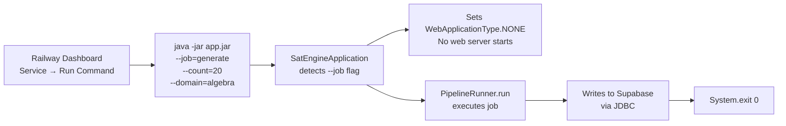

The web server does NOT start when `--job=` flag is present — the JAR acts as a CLI tool.

---

## Maven Build Configuration

### Key Dependencies

| Dependency | Version | Purpose |
|-----------|---------|---------|
| Spring Boot | 3.2.5 | Web framework |
| Spring Security + OAuth2 Client | bundled | Google authentication |
| Spring Data JPA | bundled | Database ORM |
| PostgreSQL JDBC | bundled | Database driver |
| Flyway Core | bundled | Schema migrations |
| pgvector | 0.1.6 | Vector column type |
| Anthropic Java SDK | 2.18.0 | Claude API |
| Lombok | bundled | Boilerplate reduction |
| dotenv-java | 3.0.0 | `.env` file loading |
| Sentry Spring Boot Jakarta | 7.14.0 | Error tracking |
| SpringDoc OpenAPI | 2.5.0 | Swagger UI at `/swagger-ui.html` |
| Testcontainers PostgreSQL | 1.19.8 | Test DB (spins up real Postgres) |
| OkHttp | bundled (Anthropic) | HTTP client for Claude API |

### Build Plugins

| Plugin | Purpose |
|--------|---------|
| `maven-compiler-plugin` | Java 21 + Lombok annotation processor |
| `spring-boot-maven-plugin` | Package fat JAR with all deps |
| `frontend-maven-plugin` | Install Node 22.13.0, run `npm install` + `npm run build` |

**Skip frontend:** `-Dskip.frontend=true` — used in Docker and Railway builds.

---

## Adding a New Migration — Process

Every Sprint that changes the DB schema must follow this process:

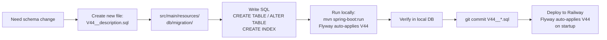

**Current version:** V43 (last migration)
**Next migrations planned:**

| Migration | Sprint | Issue | What |
|-----------|--------|-------|------|
| `V44__add_user_skill_mastery.sql` | Sprint 3 | #64 | `user_skill_mastery` table |
| `V45__add_error_type_to_session_answers.sql` | Sprint 3 | #72 | `error_type` column on `session_answers` |

**Rules:**
- Never modify an existing migration file — Flyway checksums them
- Never delete a migration file
- Always test locally before committing
- Migration filenames: `V{number}__{snake_case_description}.sql`

---

## Security Model

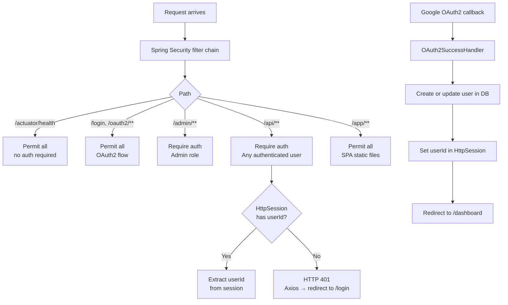

**No JWT** — session-based auth via Spring HttpSession. Sessions stored in memory (Railway) — students are logged out on container restart.

---

## Environment Summary Table

| Aspect | Local Dev | Production (Railway) |
|--------|-----------|---------------------|
| Spring Profile | `local` | `railway` |
| Secrets Source | `.env` file | Railway dashboard |
| Database | Docker PostgreSQL :5432 | Supabase PostgreSQL |
| Frontend | Vite dev server :5173 | Static files in JAR |
| OAuth2 | Disabled (DevLoginController) | Google OAuth2 |
| Pipeline jobs | `java -jar ... --job=X` | Railway "Run Command" |
| Neon sync | Available | Disabled |
| SSL | None | Auto (Railway) |
| Health checks | None | `/actuator/health` |
| Error tracking | Off | Sentry |
| Uptime monitoring | None | UptimeRobot |
| DB connections | Default HikariCP | Max 3 (pool tuned) |
| Log level (app) | DEBUG | DEBUG (→ Sentry on ERROR) |
