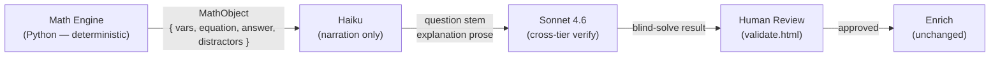
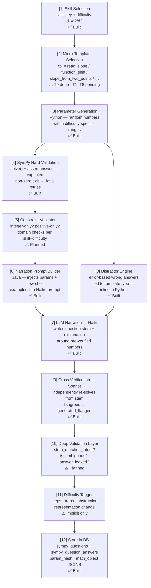
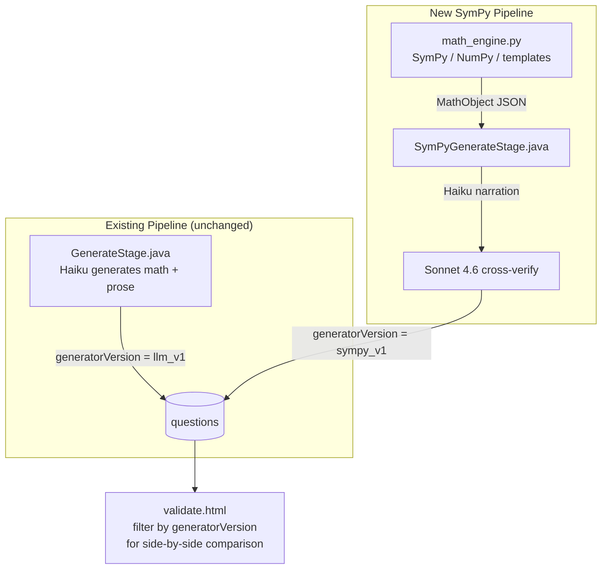
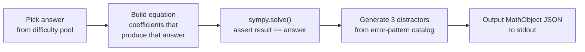
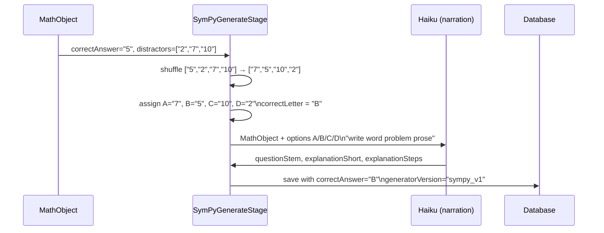
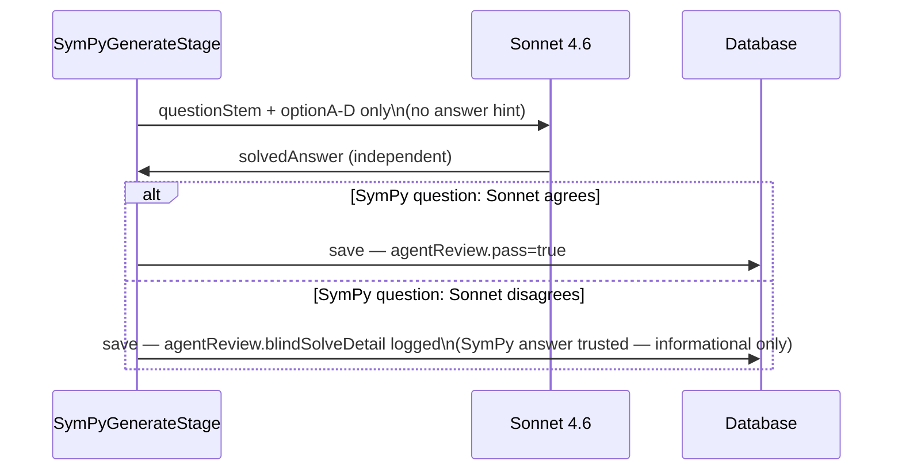
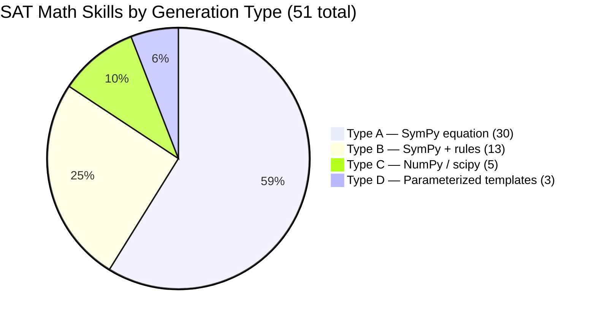
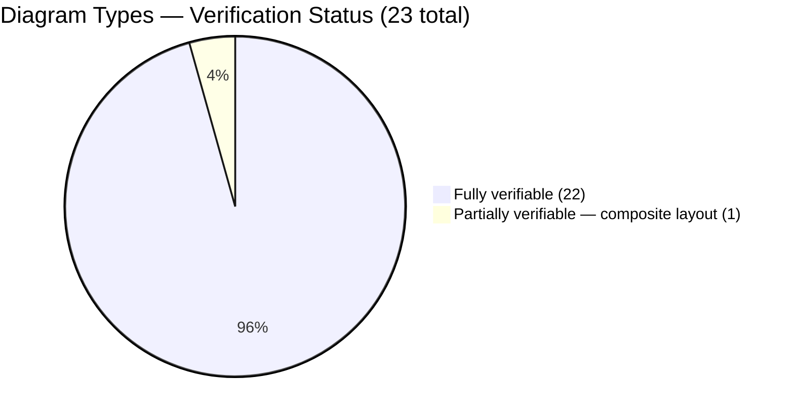
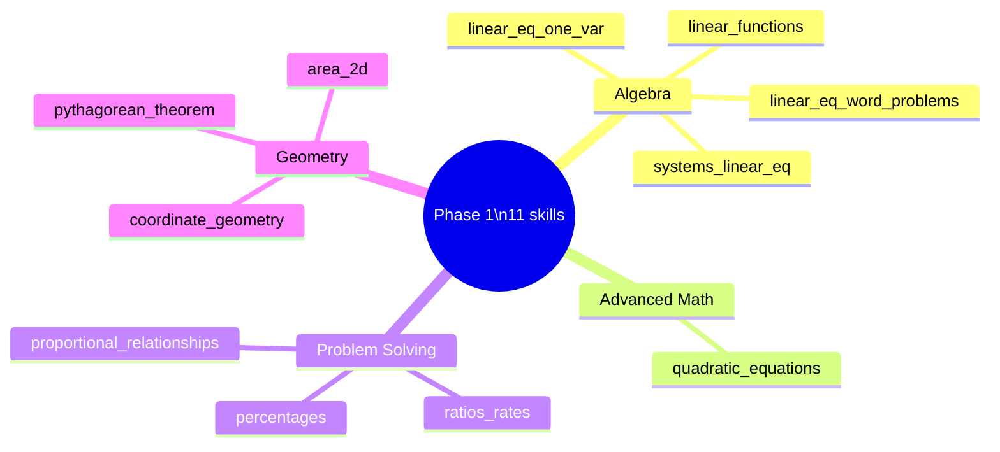
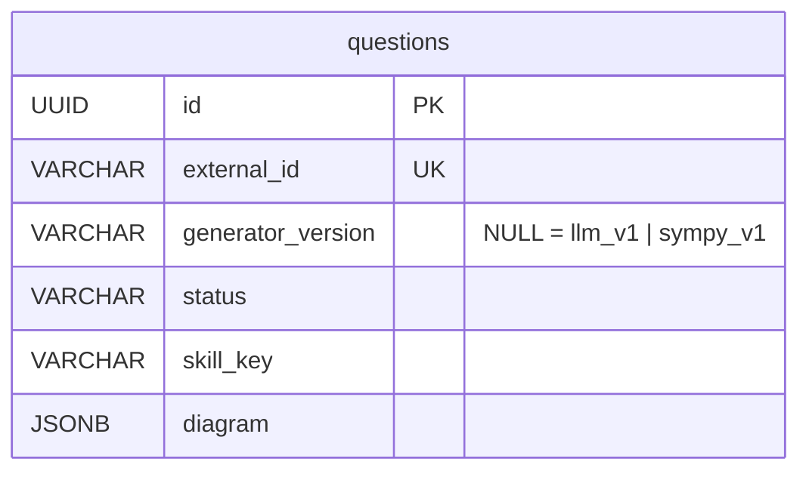

# 22 — SymPy Math Generation Pipeline

---

## 1. Why a New Pipeline?

The existing `GenerateStage` asks a single LLM call to simultaneously invent the math, compute the answer, write the word problem, and construct plausible distractors. This creates three compounding failure modes:

| Failure | Root cause | Frequency observed |
|---|---|---|
| Wrong `correctAnswer` | LLM arithmetic errors on intermediate steps | ~40% of math questions |
| Equation–narrative inconsistency | Numbers in prose don't match the equation | ~25% of math questions |
| Ineffective self-verification | Haiku verifies its own output — same blind spots | Pass rate misleadingly high |

**The fix:** Separate the math from the language. A deterministic engine generates and verifies the math first. The LLM only writes prose around pre-verified numbers it cannot change.

---

## 2. Core Principle: Generate-Then-Describe



The LLM receives a fully verified `MathObject` and writes **only prose** — it never touches a number.

---

## 2a. Full Generation Workflow (12-Node Pipeline)

Status legend: ✅ Built · ⚠️ Planned · 🔲 Not started



### Node Status Summary

| Node | Component | Status | Files |
|------|-----------|--------|-------|
| 1 | Skill + difficulty selection | ✅ | `PipelineRunner.java` CLI args |
| 2 | Micro-template selection | ⚠️ | `math_engine.py` — T9 done, T1–T8 pending |
| 3 | Parameter generation | ✅ | `math_engine.py` per-skill generator |
| 4 | SymPy hard validation | ✅ | `math_engine.py` — `assert` + non-zero exit |
| 5 | Constraint validator | ⚠️ | Planned — `validate_math_object()` in Python |
| 6 | Narration prompt builder | ✅ | `NarrationPromptLibrary.java` |
| 7 | LLM narration (Haiku) | ✅ | `SymPyGenerateStage.java` + `ClaudeClient.java` |
| 8 | Distractor engine | ✅ | `math_engine.py` — `make_distractors()` per template |
| 9 | Cross verification (Sonnet) | ✅ | `SymPyGenerateStage.java` |
| 10 | Deep validation layer | ⚠️ | Planned — extend `buildCrossVerifyPrompt()` |
| 11 | Difficulty tagger | ⚠️ | Implicit via template choice — no explicit scoring |
| 12 | DB save | ✅ | `SymPyQuestionRepository.java` + V45–V49 migrations |

---

## 3. Architecture: Two Parallel Generators

The new pipeline runs **alongside** the existing generator with zero changes to existing code. Both write to the same `questions` table. A new `generator_version` column distinguishes their output for side-by-side comparison.



**New files only — nothing existing is modified:**

| File | Purpose |
|---|---|
| `sat-engine/scripts/math_engine.py` | SymPy / NumPy math generation engine |
| `sat-engine/scripts/requirements.txt` | Python dependencies (`sympy>=1.13`, `numpy`, `scipy`) |
| `pipeline/sympy/MathObject.java` | Java record: verified math fact |
| `pipeline/sympy/MathObjectService.java` | Calls Python subprocess, parses `MathObject` |
| `pipeline/sympy/MathTemplateException.java` | Thrown on subprocess failure |
| `pipeline/sympy/SymPyGenerateStage.java` | New standalone generation stage |
| `pipeline/claude/NarrationPromptLibrary.java` | Narration-only prompts |

---

## 4. MathObject Schema

The Python engine outputs a single JSON line to `stdout`. Java reads it into a `MathObject` record.

```json
{
  "skillKey":              "linear_eq_one_var",
  "difficulty":            3,
  "questionType":          "MCQ",
  "correctAnswer":         "5",
  "vars":                  { "a": 3, "b": 7, "c": 22 },
  "equationLatex":         "\\(3x + 7 = 22\\)",
  "distractors":           ["2", "7", "10"],
  "distractorErrors":      ["forgot to subtract b", "did not divide by a", "off by one"],
  "diagramData":           null,
  "verifiedBySympyVersion": "1.13.3"
}
```

**Template design pattern — answer-first:**



---

## 5. Answer Slot Assignment (Java, not LLM)

For MCQ questions, the correct letter (A/B/C/D) is assigned by Java **deterministically** — the LLM never touches `correctAnswer`:



---

## 6. Cross-Tier Verification



For LLM-fallback questions (non-templated skills), Sonnet disagreement remains a `BLIND_SOLVE` soft flag as before.

---

## 7. Full SAT Math Taxonomy — All 51 Skills Classified

Every skill maps to one of four generation types. **All 51 skills are deterministic** — the LLM never computes math.

### Generation Type Legend

| Type | Generator | LLM role |
|---|---|---|
| **A** — SymPy equation | `sympy.solve()` | Prose wrapper only |
| **B** — SymPy + geometry rules | SymPy + angle/circle theorems | Prose wrapper only |
| **C** — NumPy/scipy data | `np.linregress`, `np.quantile` | Prose wrapper + context labels |
| **D** — Parameterized templates | Fixed claim/interpretation templates | Fill context nouns only |

---

### 7.1 Algebra — 11 skills

| Skill key | Label | Type | SymPy structure |
|---|---|---|---|
| `linear_eq_one_var` | Linear equations in one variable | **A** | `ax + b = c` → solve for x |
| `linear_eq_word_problems` | Linear equation word problems | **A** | Same as above, different narration context |
| `linear_eq_two_var` | Linear equations in two variables | **A** | Manipulate `ax + by = c` to slope-intercept or standard form |
| `graphs_linear` | Graphs of linear functions | **A** | Pick `m`, `b` → compute intercepts, intersection |
| `linear_functions` | Linear functions | **A** | `f(x) = mx + b` → evaluate, find slope, find x |
| `linear_functions_word_problems` | Linear function word problems | **A** | Same as above, word problem narration |
| `systems_linear_eq` | Systems of two linear equations | **A** | `sympy.solve([eq1, eq2], [x, y])` |
| `systems_linear_word_problems` | Systems — word problems | **A** | Same as above, word problem narration |
| `linear_inequalities_one_var` | Linear inequalities in one variable | **B** | SymPy `solve_univariate_inequality` + flip-direction distractor |
| `linear_inequalities_two_var` | Linear inequalities in two variables | **B** | Pick boundary line + test point → determine shade direction |
| `systems_linear_inequalities` | Systems of linear inequalities | **B** | Two inequalities → compute corner points + feasible region test point |

---

### 7.2 Advanced Math — 12 skills

| Skill key | Label | Type | SymPy structure |
|---|---|---|---|
| `equivalent_expressions` | Equivalent expressions | **B** | `sympy.expand()` / `factor()` + 6-error-pattern distractors |
| `polynomial_operations` | Operations with polynomials | **A** | `sympy.expand(poly1 + poly2)` or multiply |
| `factoring` | Factoring quadratic/polynomial | **A** | `sympy.factor()` with guaranteed integer roots |
| `quadratic_equations` | Solving quadratic equations | **A** | `sympy.solve(ax²+bx+c, x)` — integer/rational roots at d1–d5 |
| `quadratic_functions` | Quadratic functions and graphs | **B** | Pick `a,h,k` → vertex `(h,k)`, axis `x=h`, roots, y-intercept all computed |
| `exponential_functions` | Exponential functions | **A** | `f(x) = a·bˣ` → evaluate at x, or solve for x |
| `polynomial_functions` | Polynomial functions | **B** | Evaluate at point + end-behavior from leading term |
| `radicals_rational_exponents` | Radicals and rational exponents | **B** | `sympy.radsimp()` + 5-error-pattern distractors |
| `rational_expressions` | Rational expressions and equations | **B** | `sympy.cancel()` + domain restriction distractor |
| `radical_rational_abs_equations` | Radical, rational, abs value equations | **A** | `sympy.solve()` handles all three |
| `nonlinear_eq_systems` | Systems: one linear + one nonlinear | **A** | `sympy.solve([linear, quadratic], [x, y])` |
| `function_notation` | Function notation / composition | **B** | `f.subs(x, value)` → evaluate; `f.subs(x, g(x))` → compose |

---

### 7.3 Problem Solving & Data Analysis — 13 skills

| Skill key | Label | Type | Generator |
|---|---|---|---|
| `ratios_rates` | Ratios and rates | **A** | `a/b = c/d` → solve for one variable |
| `proportional_relationships` | Proportional relationships | **A** | Same structure as ratios |
| `unit_conversion` | Units and unit conversion | **A** | Factor-label: `value × (unit1/unit2)` — exact |
| `percentages` | Percentages | **A** | `new = old × (1 ± p/100)` → solve for any variable |
| `data_center` | Measures of center | **C** | `np.mean()`, `np.median()` on generated dataset |
| `data_spread` | Measures of spread | **C** | `np.std()`, IQR from `np.quantile([0.25, 0.75])` |
| `data_distributions` | Data distributions | **C** | `np.random.exponential/normal` → shape label determined by `mean > median` |
| `scatterplots` | Scatterplots and lines of best fit | **C** | `scipy.stats.linregress` → slope, intercept, R² exact |
| `two_var_models` | Two-variable data models | **D** | Slope + units → fixed interpretation template (4 distractor types) |
| `probability` | Probability | **A** | Integer counts → exact fraction `favourable/total` |
| `conditional_probability` | Conditional probability / two-way tables | **A** | Generate integer table → `P(A|B) = n(A∩B)/n(B)` |
| `inference_statistics` | Inference from samples | **D** | Pre-compute: `n`, `p̂`, `z=1.96`, `ME`, CI bounds → LLM writes scenario |
| `evaluating_claims` | Evaluating statistical claims | **D** | ~20 fixed claim templates; LLM fills context nouns only |

---

### 7.4 Geometry & Trigonometry — 13 skills

| Skill key | Label | Type | SymPy / formula |
|---|---|---|---|
| `area_2d` | Area of 2D figures | **A** | Rectangle `l×w`, triangle `½bh`, circle `πr²` |
| `perimeter_2d` | Perimeter and circumference | **A** | Rectangle `2(l+w)`, circle `2πr` |
| `volume_surface_area` | Volume and surface area | **A** | Box, sphere, cylinder, cone — all formula-based |
| `lines_angles` | Lines and angles | **B** | Pick one acute angle → all 8 transversal angles computed |
| `triangles` | Triangle properties | **B** | Angle sum = 180°; exterior angle theorem |
| `similar_congruent_triangles` | Similar and congruent triangles | **A** | Scale factor → corresponding sides proportional |
| `pythagorean_theorem` | Pythagorean theorem | **A** | Pythagorean triples → `sympy.solve(a²+b²-c², c)` |
| `special_right_triangles` | Special right triangles | **A** | 30-60-90 and 45-45-90 exact ratios |
| `right_triangle_trig` | Right triangle trigonometry | **A** | `sin/cos/tan` at known angles — exact values |
| `unit_circle_radians` | Radian measure and arc length | **A** | `arc = r·θ`; degree ↔ radian conversion |
| `circle_properties` | Circle properties — arcs and angles | **B** | Inscribed angle = arc/2; central angle = arc |
| `circle_equations` | Equation of a circle | **A** | Complete the square → center `(h,k)` + radius |
| `coordinate_geometry` | Coordinate geometry | **A** | Midpoint, distance, slope — all exact from integer coordinates |

---

## 8. Coverage Summary



| Type | Count | Coverage |
|---|---|---|
| A — SymPy equation | 30 | 59% |
| B — SymPy + geometry/algebra rules | 13 | 25% |
| C — NumPy / scipy data generation | 5 | 10% |
| D — Parameterized templates | 3 | 6% |
| **Total** | **51** | **100%** |

All 51 skills are deterministic. **Zero skills require the LLM to compute math.**

---

## 9. Distractor Catalog

LLM-generated distractors score 2.68/5 for plausibility vs 3.72/5 for catalog-based distractors (arXiv 2404.02124). Every skill has 3 pre-enumerated error patterns applied programmatically.

### Algebra

| Skill family | Error → distractor |
|---|---|
| Linear equations | Sign flip on `b` · forgot to divide by `a` · off-by-one from answer |
| Systems | Solved only one equation · substituted wrong variable · arithmetic sign error |
| Inequalities | Forgot to flip direction when dividing by negative · solved equality not inequality · dropped negative coefficient |

### Advanced Math

| Skill family | Error → distractor |
|---|---|
| Quadratics | FOIL skip: `(x+3)² → x²+9` · factored wrong sign · used discriminant wrong |
| Equivalent expressions | Partial GCF (factor 2 instead of 6) · sign distribution error · cancellation error |
| Radicals | Partial simplification (non-maximal factor) · multiply exponents instead of add · scope error |
| Rational expressions | Cancel terms not factors · forget domain restriction `x≠a` · flip numerator/denominator |
| Functions | Binomial expansion skip · composition order flip · substitute into one term only |

### Problem Solving & Data

| Skill family | Error → distractor |
|---|---|
| Ratios/proportions | Cross-multiply in wrong order · add instead of multiply · use wrong ratio |
| Percentages | Add percent as absolute (forgot base) · subtract instead of multiply · compute wrong direction |
| Statistics | Mean ↔ median confusion · use n instead of √n for SE · misidentify skew direction |
| Probability | Include event twice · divide by wrong total · confuse P(A∩B) with P(A|B) |

### Geometry & Trigonometry

| Skill family | Error → distractor |
|---|---|
| Triangles / Pythagorean | Add sides instead of using Pythagorean · use wrong leg as hypotenuse · forget to take √ |
| Angles | Supplement instead of equal · confuse alternate interior with co-interior · wrong transversal angle |
| Circles | Confuse inscribed angle with central angle (use arc instead of arc/2) · subtract from 360 wrong |
| Trig | Confuse sin with cos · use degrees instead of radians · reciprocal function error |
| Area/Volume | Use wrong formula for shape · forget factor of ½ for triangle · use diameter instead of radius |

---

## 10. Mathematical Diagram Types — New Pipeline Coverage

With the new pipeline, diagram data flows from `MathObject` into the renderer — the LLM never invents numbers for a diagram. Verification re-runs the math against values stored in the diagram JSON.

### 10.1 SVG Programmatic Diagrams

| Diagram type | Key stored fields | Generated from | Verification assertion |
|---|---|---|---|
| `triangle` / `right_triangle` | `vertices[]`, `sides[]`, `angles[]` | SymPy — side lengths from Pythagorean / trig | `a²+b²=c²`; angles sum to 180°; vertices consistent with labeled sides |
| `circle` | `cx`, `cy`, `radius`, `sectors[]`, `arcs[]`, `inscribedAngles[]` | SymPy — circle equation or arc/angle relationships | Inscribed angle = arc/2; arcs sum to 360°; radius matches equation |
| `coordinate_plane → function_graph` | `functions[]{type, params}`, `points[]` | SymPy — function parameters (m,b / a,b,c) | Sample x-values: `f(x)` matches labeled intercept/vertex |
| `coordinate_plane → system_of_equations` | `functions[]`, `intersections[]` | SymPy `solve([eq1,eq2])` | Substitute intersection `(x,y)` into both equations |
| `coordinate_plane → inequality` | `inequalities[]{operator, shadeAbove}` | SymPy inequality solution | Test point in shaded region satisfies inequality; test point outside does not |
| `venn_diagram` | `sets[]{value}`, `intersection{value}`, `universal{value}`, `outside` | SymPy / integer counts (probability) | A-only + B-only + intersection + outside = universal total |
| `normal_curve` | `mean`, `stdDev`, `shadedRegions[]` | NumPy dataset → `np.mean`, `np.std` | Shaded bounds match z-scores; mean/stdDev match dataset statistics |
| `rectangle` / `parallelogram` / `trapezoid` | `vertices[]`, `sides[]` | SymPy area/perimeter formulas | Area = l×w; perimeter = 2(l+w); vertices geometrically consistent |
| `regular_polygon` | `sides` (count), `rotationDeg` | SymPy (n, rotation) | Interior angle sum = (n−2)×180°; all sides equal by construction |
| `3d_shape` | `type`, `labels{length,width,height,radius,...}` | SymPy volume/surface area | Recompute V or SA from labeled dimensions; assert = expected answer |
| `angle_figure` | `angles[]{vx,vy,ray1Angle,ray2Angle}` | SymPy (one angle → all computed) | Supplementary pairs sum to 180°; vertical angles equal |
| `parallel_transversal` | Angle labels at intersection | SymPy (one acute angle → all 8) | Alternate interior = corresponding; co-interior sum = 180° |
| `two_triangles` | `triangle1/2{vertices[]}`, `scaleFactor` | SymPy similarity ratio | Corresponding side ratios equal scale factor |
| `number_line` | `min`, `max`, `points[]{value, style}` | SymPy inequality solution | Point position = solution value; endpoint type matches `<` vs `≤` |
| `triangle_with_altitude` | Triangle vertices + altitude | SymPy area = ½×base×height | Altitude forms 90° with base; area formula holds |
| `composite` | `shapes[]{offsetX,offsetY,...}` | SymPy sub-shape dimensions | Total area = sum of parts *(offset layout: partial)* |

### 10.2 Chart.js Statistical Diagrams

| Diagram type | Key stored fields | Generated from | Verification assertion |
|---|---|---|---|
| `bar` | `categories[]`, `datasets[]{data[]}` | NumPy category counts | Bar heights match source array; categorical totals correct |
| `histogram` | `bins[]`, `frequencies[]` | NumPy `np.histogram()` | Frequencies sum to n; bin boundaries match step size |
| `line` | `datasets[]{data[]}`, x-axis values | SymPy function values at x-points | Sampled points satisfy `f(x)`; slope/growth rate consistent with params |
| `scatter` + regression | `data[]`, `regressionLine{slope,intercept}` | `scipy.stats.linregress` | Regression line passes through `(x̄, ȳ)`; slope/intercept match linregress output |
| `pie` | `labels[]`, `data[]` | SymPy / NumPy proportions | All slices sum to 100% (or total count) |
| `boxplot` | `min`, `q1`, `median`, `q3`, `max` | `np.quantile([0,0.25,0.5,0.75,1])` | Q1/Q3/median match NumPy output; IQR = Q3−Q1; whiskers within 1.5×IQR |
| `dotplot` | `data[]` (individual values) | NumPy individual data points | Dot count = n; each position maps to a value in dataset |

### 10.3 Coverage



**22 of 23 SAT-relevant diagram types are fully verifiable programmatically.**  
Verification pattern: `MathObject → generate diagram JSON → extract values → re-run math → assert match`

---

## 11. Phase 1 — Skills to Template First

Phase 1 covers the highest-frequency skills across SAT math with exact taxonomy keys:



Phase 2 expands to the remaining Type A skills. Phase 3 covers Type B/C. Type D templates are authored by hand.

---

## 12. Comparison Metrics

After generating questions from both pipelines, evaluate on:

| Metric | Query |
|---|---|
| Correct answer accuracy | Sonnet blind-solve pass rate, grouped by `generator_version` |
| Blind-solve mismatch rate | `agentReview.blindSolveMismatch = true` count / total |
| Human approval rate | `status = approved` / total, by `generator_version` |
| Human rejection rate | `status = rejected` / total, by `generator_version` |
| Agent review pass rate | `agentReview.pass = true` / total |
| Distractor quality | Human-rated plausibility score (1–5) per distractor |

---

## 13. DB Change

One additive migration — no existing columns modified:

```sql
-- V{N}__add_generator_version.sql
ALTER TABLE questions ADD COLUMN generator_version VARCHAR(20);
-- Existing questions: NULL (treated as 'llm_v1')
-- New SymPy questions: 'sympy_v1'
```



---

## 14. References

| Source | Finding used |
|---|---|
| arXiv 2404.02124 | LLM distractors score 2.68/5 vs 3.72/5 for catalog-based |
| arXiv 2405.05144 | Overgenerate-and-rank improves LLM distractors but needs student data |
| arXiv 2402.17644 | GPT-4 only 58% accurate on statistical reasoning tasks |
| arXiv 2510.25975 (SymCode) | Neuro-symbolic: symbolic solver for correctness + LLM for language |
| Khan Academy (Khanmigo) | Pre-computes graph data; LLM reads structured description, does not generate math |
| Lamar University algebra errors | Canonical student error patterns for distractor catalog |
| College Board SAT Skill Framework | Official 51-skill taxonomy used for all skill keys |
