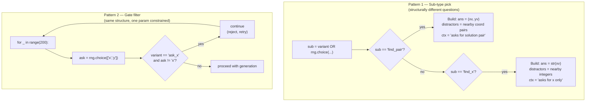

# 26 — SymPy Pipeline: Full Flow Diagram

> How a variant name becomes a question in the database.

---

## End-to-End Flow

```mermaid
flowchart TD
    subgraph UI["pipeline.html (browser)"]
        U1["Select skill\ne.g. systems_linear_eq"]
        U2["Select template\ne.g. graph_reading"]
        U3["Select variant\ne.g. find_pair\n(or leave blank for all)"]
        U4["Click Generate"]
    end

    subgraph API["Java REST — SymPyAdminController"]
        A1["POST /api/admin/sympy/generate\n?skill=&template=&variant=&count="]
        A2["PipelineJobService.startSympyJob()"]
    end

    subgraph Stage["Java — SymPyGenerateStage"]
        S1{"Which path?"}
        SA["Path A\ntemplate + variant\n→ generate exactly 1"]
        SB["Path B\ntemplate only\n→ resolveVariants()\n→ 1 per variant"]
        SC["Path C\nneither\n→ loop count times"]
        S2["generateOne(skill, diff, pool,\nforceTemplate, forceVariant)"]
    end

    subgraph PY["Python — math_engine.py"]
        P1["Receive args\n--skill --difficulty --template --variant"]
        P2["gen_systems_linear_eq(\n  force_template='graph_reading',\n  force_variant='find_pair'\n)"]
        P3["_ROUTING lookup\n_D1['graph_reading']['fn']"]
        P4["_d1_graph_reading(\n  rng_obj, exclude_params,\n  variant='find_pair'\n)"]
        P5{"retry loop\nup to 200×"}
        P6["Generate random params\nm1, m2, xv, yv, b1, b2"]
        P7{"variant gate\nif sub != 'find_pair': continue"}
        P8["Build MathObject\n{ params, verifiedAnswer,\n  distractors, questionContext,\n  diagramSpec }"]
        P9["print JSON to stdout"]
    end

    subgraph VAR["Variant Registry\n(routing dict in systems.py)"]
        V1["_D1 = {\n  'graph_reading': {\n    fn: _d1_graph_reading,\n    variants: ['find_pair','find_x']\n  },\n  ...\n}"]
    end

    subgraph NARR["Java — Narration (Claude Haiku)"]
        N1["MathObjectService\nreads stdout JSON"]
        N2["Deduplicate\nparam_hash check vs DB"]
        N3["Shuffle answer slots\nFisher-Yates (Java)"]
        N4["ExampleLoader\nload narration/examples/\nsystems_linear_eq.json\nfilter by difficulty tier\npick up to 3 examples"]
        N5["NarrationPromptLibrary\nbuildNarrationPrompt(\n  mo, optionA-D,\n  examplesBlock\n)"]
        N6["Claude Haiku\nwrites prose ONLY\nnever touches numbers"]
        N7["Haiku response\n{ questionStem,\n  explanationSteps,\n  coreConcept,\n  distractorRationale }"]
    end

    subgraph VERIFY["Java — Cross-Verify (Claude Sonnet)"]
        CV1["Sonnet blindly solves\nquestionStem only\n(no answer given)"]
        CV2{"Sonnet answer\n== verifiedAnswer?"}
        CV3["status = 'generated'\n(passes review queue)"]
        CV4["status = 'generated_flagged'\n(soft flag — not blocked)"]
    end

    subgraph DB["Postgres"]
        DB1["sympy_questions\n+ sympy_question_answers"]
    end

    subgraph REVIEW["Human Review — sympy-review.html"]
        R1["Admin views question\n+ diagram + choices"]
        R2{"Approve / Reject /\nApprove & Promote"}
        R3["status = 'approved'"]
        R4["status = 'rejected'"]
        R5["SymPyPromoteService\ncopy → production questions table"]
    end

    subgraph VARIANTS_API["GET /api/admin/sympy/variants"]
        VA1["MathObjectService\n.listVariants(skill, diff, template)"]
        VA2["math_engine.py --list-variants\n→ sle_variants(1, 'graph_reading')\n→ {variants: ['find_pair','find_x']}"]
        VA3["JSON returned\nto browser dropdown"]
    end

    %% UI flow
    U1 --> U2
    U2 -->|"onTemplateSelect()\nfetch /api/admin/sympy/variants"| VARIANTS_API
    VARIANTS_API --> VA1 --> VA2 --> VA3 --> U3
    U3 --> U4

    %% REST trigger
    U4 --> A1 --> A2

    %% Path routing
    A2 --> Stage
    S1 -->|"template + variant"| SA --> S2
    S1 -->|"template only"| SB --> S2
    S1 -->|"neither"| SC --> S2

    %% Python invocation
    S2 -->|"shells out"| P1
    P1 --> P2
    P2 --> P3
    P3 -->|"fn lookup"| VAR
    VAR --> P4
    P4 --> P5
    P5 --> P6
    P6 --> P7
    P7 -->|"wrong variant\nreject"| P5
    P7 -->|"correct variant\naccept"| P8
    P8 --> P9

    %% Java reads Python output
    P9 --> N1
    N1 --> N2
    N2 -->|"duplicate"| DB1
    N2 -->|"new"| N3
    N3 --> N4
    N4 --> N5
    N5 --> N6
    N6 --> N7
    N7 --> VERIFY

    %% Verify
    CV1 --> CV2
    CV2 -->|"match"| CV3
    CV2 -->|"mismatch"| CV4
    CV3 --> DB1
    CV4 --> DB1

    %% Review
    DB1 --> R1
    R1 --> R2
    R2 -->|"approve"| R3 --> DB1
    R2 -->|"reject"| R4 --> DB1
    R2 -->|"approve & promote"| R5 --> DB1
```



---

## Variant Gate Detail

How the variant string controls which question gets generated inside a template function:



---

## Where Each Piece Lives

| What | Where |
|---|---|
| Variant **names** (registry) | `_D1/_D2/_D3` routing dicts in each skill `.py` file |
| Variant **behaviour** (gates) | `if variant == "x" …` inside each `_d1_*` function |
| Variant **metadata API** | `sle_variants()` / `leq_variants()` / `l2v_variants()` / `lin_variants()` |
| Variant **exposed to Java** | `MathObjectService.listVariants()` → `--list-variants` CLI |
| Few-shot **style examples** | `src/main/resources/narration/examples/<skill>.json` |
| Example **loader** | `ExampleLoader.buildExamplesBlock(skill, difficulty)` |
| **Narration prompt** builder | `NarrationPromptLibrary.buildNarrationPrompt()` |
| **Prose writer** | Claude Haiku (never touches numbers) |
| **Cross-verifier** | Claude Sonnet (blind-solves; soft flag only) |
| **Generated questions** | `sympy_questions` + `sympy_question_answers` tables |
| **Production questions** | `questions` table (after approve & promote) |

---

## Key Design Principle

```
Python  →  WHAT (math: params, answer, distractors, questionContext)
Haiku   →  HOW  (prose: stem, explanation steps, distractor rationale)
Sonnet  →  CHECK (blind-solve: does the stem actually ask what Python computed?)
```

The variant string is **only a Python concern** — Java and Haiku never see it after generation.
The examples JSON is **only a Haiku concern** — Python and Sonnet never see it.
